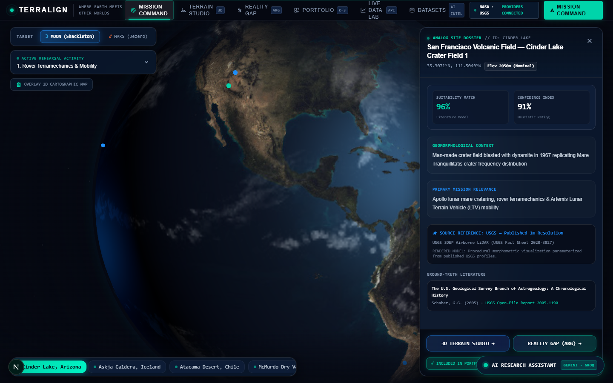
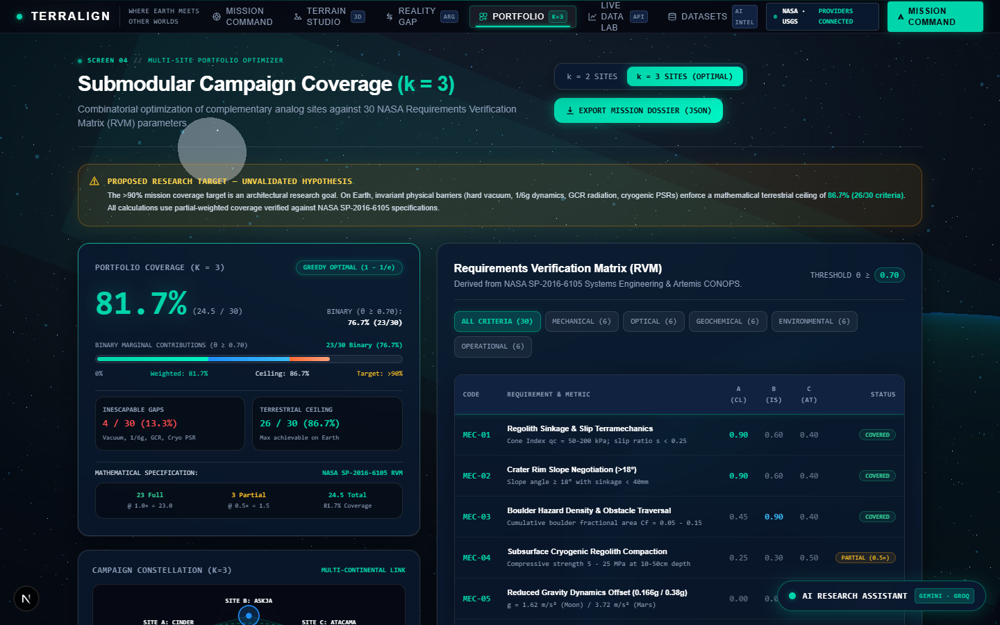
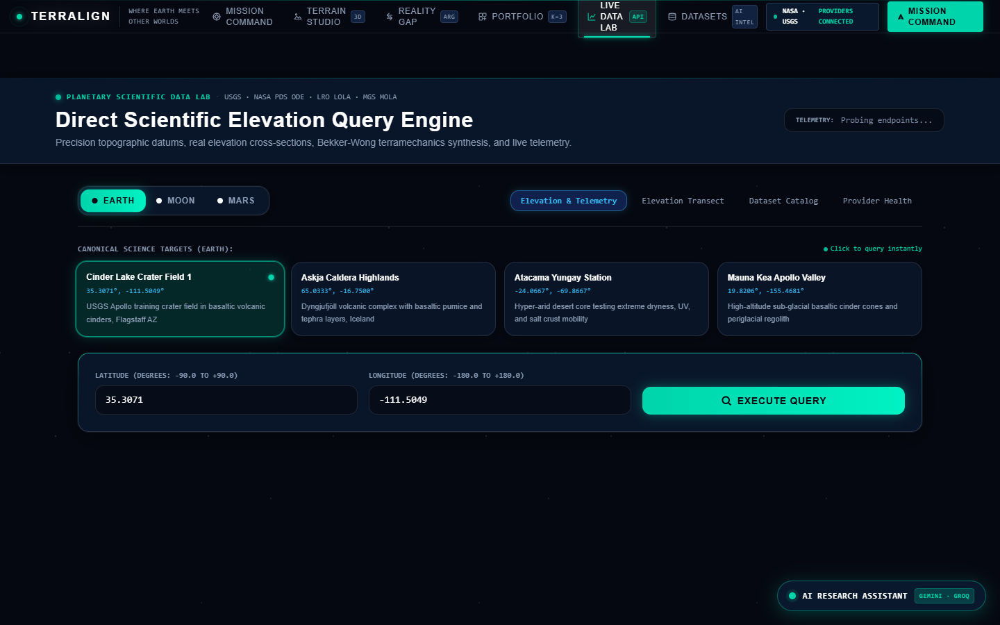
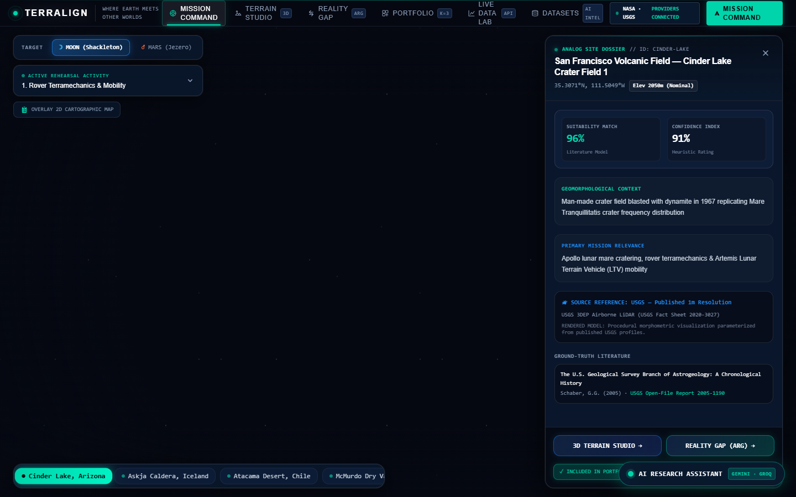
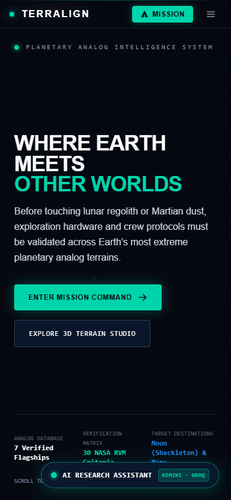
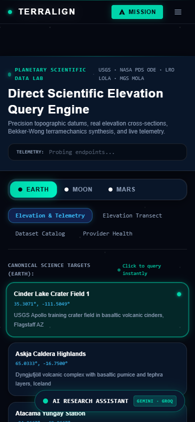
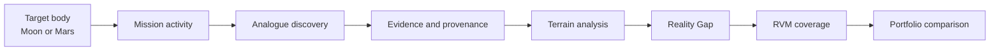
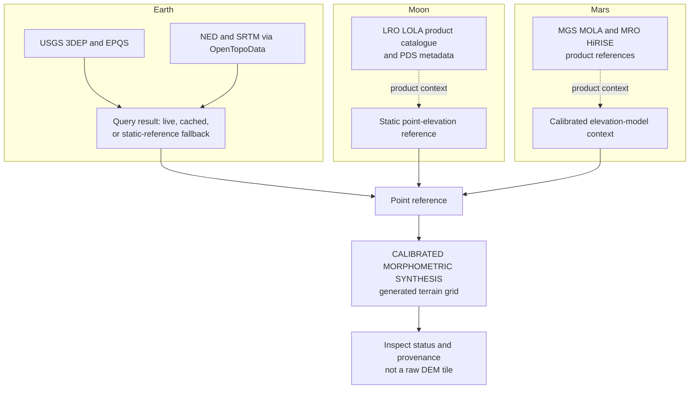
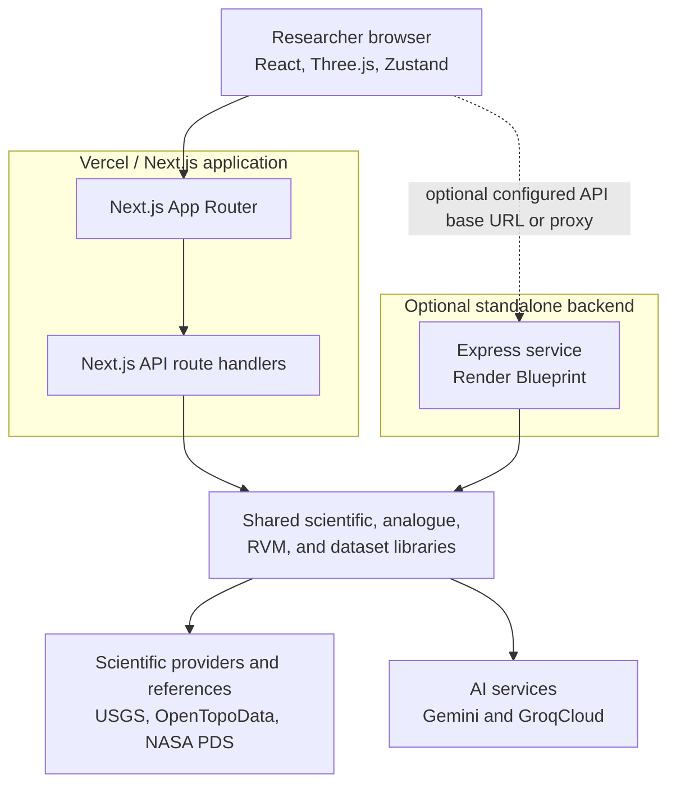

<div align="center">

# TERRALIGN 2.0

### Where Earth Meets Other Worlds

**An evidence-aware planetary analogue intelligence platform for lunar and Martian mission research.**

Discover terrestrial environments, explore terrain, and compare mission requirements—while keeping the limits of every analogue visible.

[](https://terralign-green.vercel.app)
[](https://github.com/selfabhijeetkumar/terralign)


<a href="https://terralign-green.vercel.app">
  
</a>

*An independent NEXARC project created for the NASA Space Apps Challenge.*

</div>

---

## **Mission brief**

Future lunar and Martian missions need places on Earth where teams can rehearse operations, investigate terrain, and evaluate equipment. Yet **no terrestrial environment is an exact replica of another world**. Gravity, atmosphere, radiation, temperature, regolith behavior, and weathering all limit what an Earth-based analogue can represent.

TERRALIGN helps researchers discover and compare terrestrial sites for specific mission activities. It brings together a curated analogue knowledge base, planetary topographic references, interactive 3D terrain views, a Requirement Verification Matrix (RVM), Reality Gap diagnostics, portfolio comparison, personal dataset analysis, and AI-assisted interpretation.

The intended benefit is more transparent early-stage analogue research: researchers can explore where a site may be useful, review the evidence behind a comparison, and identify differences that need further investigation.

> **Core principle: resemblance is not equivalence.** A site can be valuable for one research question while remaining a poor match for another.

**Challenge context:** “Discovery and Characterization of New Terrestrial Analogs for Lunar and Martian Exploration.”

TERRALIGN is an independent student project. It is **not an official NASA product**, and NASA does not endorse it.

---

## **Explore the platform**

The following application captures are referenced from `docs/design/screenshots/`.

<table>
<tr>
<td width="50%" valign="top">
  <a href="docs/design/screenshots/cosmic-mission-1440-scroll0.png"></a>
  <strong>01 · Mission Command</strong><br>
  Choose a target world and mission activity, explore analogue candidates, and inspect site context.
</td>
<td width="50%" valign="top">
  <a href="docs/design/screenshots/cosmic-terrain-1440-scroll0.png"></a>
  <strong>02 · Terrain Studio</strong><br>
  Compare Earth and extraterrestrial terrain representations in synchronized 3D viewports.
</td>
</tr>
<tr>
<td width="50%" valign="top">
  <a href="docs/design/screenshots/cosmic-reality-gap-1440-scroll0.png"></a>
  <strong>03 · Reality Gap</strong><br>
  Review mission-relevant physical and operational differences.
</td>
<td width="50%" valign="top">
  <a href="docs/design/screenshots/cosmic-portfolio-1440-scroll0.png"></a>
  <strong>04 · Portfolio Optimizer</strong><br>
  Compare combinations of analogue sites using the RVM coverage framework.
</td>
</tr>
<tr>
<td width="50%" valign="top">
  <a href="docs/design/screenshots/cosmic-live-data-1440-scroll0.png"></a>
  <strong>05 · Live Data Lab</strong><br>
  Query supported elevation sources, inspect transects, browse datasets, and review provider status.
</td>
<td width="50%" valign="top">
  <a href="docs/design/screenshots/cosmic-datasets-1440-scroll0.png"></a>
  <strong>06 · Dataset Manager</strong><br>
  Upload and inspect supported geospatial and tabular files.
</td>
</tr>
</table>

### **Cosmic Ascension visual system**

The interface combines a procedural space environment, luminous panels, and a subtle card-shine effect. On supported desktop devices, a custom celestial-dragon pointer is rendered with Canvas2D.

<div align="center">
  <a href="docs/design/screenshots/cosmic-dragon-cursor-active.png"></a>
  <br><strong>Cosmic Dragon Cursor</strong> · Procedural Canvas2D rendering
</div>

### **Responsive views**

<table>
<tr>
<td width="50%" align="center" valign="top">
  <a href="docs/design/screenshots/cosmic-home-390.png"></a>
  <br><strong>Mobile home</strong><br>
  The introductory experience at a narrow viewport width.
</td>
<td width="50%" align="center" valign="top">
  <a href="docs/design/screenshots/cosmic-live-data-390.png"></a>
  <br><strong>Mobile Live Data Lab</strong><br>
  The data exploration interface at a narrow viewport width.
</td>
</tr>
</table>

More captures: [desktop home, mid-page](docs/design/screenshots/cosmic-home-1440-scroll50.png) · [desktop home, footer](docs/design/screenshots/cosmic-home-1440-scroll100.png).

---

## **From mission question to analogue portfolio**

A researcher selects a target world and mission activity, then examines candidate sites and the evidence behind them. Terrain views help explore form and lighting. Reality Gap diagnostics keep physical differences visible, while the RVM helps compare requirement coverage for individual sites and portfolios.



The platform also supports personal dataset exploration and AI-assisted interpretation. These tools assist research; they do not replace source data, field measurements, or expert review.

| Capability | Research use |
|---|---|
| **Mission-specific discovery** | Filter and rank landscapes for activities including rover mobility, extravehicular activity (EVA), low-angle lighting studies, cryogenic drilling, lava-tube exploration, fluvial science, landing-hazard analysis, and in-situ resource utilization (ISRU) research. |
| **3D Terrain Studio** | Explore topographic form, lighting, slopes, and morphology through interactive comparisons. |
| **Reality Gap** | Review Earth-to-Moon or Earth-to-Mars differences rather than treating resemblance as equivalence. |
| **Requirement Verification Matrix** | Inspect requirement coverage across individual sites and multi-site portfolios. |
| **Portfolio Optimizer** | Compare site combinations and the additional requirement coverage they contribute. |
| **Live Data Lab** | Explore supported elevation queries, transects, planetary dataset references, and provider status. |
| **Dataset Manager** | Inspect supported user-provided geospatial and tabular files. |
| **AI Research Assistant** | Request research-oriented explanations and comparative synthesis with model and provenance disclosures. |

---

## **Scientific data and provenance**

TERRALIGN combines provider-backed point queries, planetary product references, curated values, and calibrated or procedural models. These categories are **not interchangeable**: a query result, a catalogue entry, a static reference, and generated terrain have different evidentiary status.



### **Source catalogue**

| Domain | Provider or product | Use represented in TERRALIGN |
|---|---|---|
| **Earth** | [USGS 3DEP](https://www.usgs.gov/3d-elevation-program) and [Elevation Point Query Service](https://epqs.nationalmap.gov/) | Supported point-elevation queries for US coverage, including selected high-resolution requests. |
| **Earth** | [USGS National Elevation Dataset (NED)](https://www.usgs.gov/3d-elevation-program) via [OpenTopoData](https://www.opentopodata.org/) | Supported elevation queries and terrestrial analogue reference points. |
| **Earth** | [NASA SRTM 1-arc-second / 30 m product](https://www.earthdata.nasa.gov/data/instruments/srtm) via OpenTopoData | Global elevation fallback or reference where supported by the provider chain. |
| **Moon** | [NASA Lunar Reconnaissance Orbiter (LRO) Lunar Orbiter Laser Altimeter (LOLA)](https://pds-geosciences.wustl.edu/lro/lro-l-lola-3-rdr-v1/) | Lunar topographic product catalogue and PDS Orbital Data Explorer metadata discovery; the current point-elevation model is labelled as a static reference. |
| **Mars** | [NASA Mars Global Surveyor (MGS) Mars Orbiter Laser Altimeter (MOLA)](https://pds-geosciences.wustl.edu/mgs/mgs-m-mola-5-megdr-l3-v1/) | Martian topographic product reference and calibrated elevation-model context. |
| **Mars** | [NASA Mars Reconnaissance Orbiter (MRO) HiRISE Digital Terrain Models](https://www.uahirise.org/dtm/) | Targeted high-resolution terrain product references, including Jezero-related context. |

Additional resources: [NASA Planetary Data System (PDS)](https://pds.nasa.gov/) · [PDS Geosciences Node Orbital Data Explorer](https://oderest.rsl.wustl.edu/live2/) · [OpenTopoData](https://www.opentopodata.org/).

### **Scientific limitations**

- **Earth elevation:** Provider-backed queries may return live data, cached data, or a static-reference fallback. Check the result’s epistemic status and source metadata.
- **Moon and Mars elevation:** NASA product metadata discovery is not the same as retrieving a raw, live altimeter measurement for every coordinate. Current point-elevation logic includes static or calibrated reference models.
- **3D terrain grids:** The implementation is labelled **`CALIBRATED MORPHOMETRIC SYNTHESIS`**. It generates a morphometric model anchored to a point reference—not a raw DEM tile or direct spacecraft telemetry.
- **Analogue interpretation:** A terrestrial site may be useful for a particular rehearsal while remaining physically different from the Moon or Mars.
- **Alignment index:** The **`MODEL-ASSESSED / HEURISTIC ALIGNMENT INDEX`** is not experimental proof, scientific consensus, or an independent measurement of physical similarity.

---

## **Personal datasets**

The Dataset Manager supports inspection of user-provided files, including metadata, spatial bounds, elevation summaries, and data quality where applicable.

| Format | Extensions |
|---|---|
| CSV | `.csv` |
| TSV | `.tsv` |
| JSON | `.json` |
| GeoJSON | `.geojson` |
| Excel workbook | `.xlsx` |
| GeoTIFF raster | `.tif`, `.tiff` |

Uploads are limited to **5 MB**. Workbook and raster inputs receive additional validation, and macro-enabled `.xlsm` files are rejected. User-provided data should not be confused with TERRALIGN’s curated scientific references.

---

## **AI assistance and disclosure**

The documented deployment configuration integrates:

| Service | Configured model |
|---|---|
| Google Gemini | `gemini-2.5-flash` |
| GroqCloud | `openai/gpt-oss-120b` |

The AI Research Assistant supports research-oriented explanation and comparative synthesis. The alignment index combines a calculated slip-difference component with structured heuristic baseline dimensions. **Neither AI output nor the index is scientific ground truth or experimentally validated consensus.** Consult primary datasets, citations, field measurements, and subject-matter experts before drawing research conclusions.

AI tools were also used as development aids. Antigravity IDE agent, OpenAI ChatGPT, Claude, and GPT-6 Luna supported implementation planning, code generation and refinement, debugging, visual-design prompt development, technical review, and documentation. AI-assisted code and generated explanations are reviewed against application requirements and available source data.

The visual environment and cursor effects are procedural software-rendered effects; the screenshots are application captures. If AI-generated images, video, or audio are added to the final submission, identify them as AI-generated in accordance with the event’s instructions. Do not use, reproduce, or modify NASA logos, insignia, mission patches, or other NASA branding in AI-generated material.

---

## **Architecture**

The deployment report records the Vercel application as live. The Next.js application can serve its native API routes. The repository also includes a separate Express service and Render Blueprint for optional backend deployment.



The dashed path applies only if the standalone service is deployed and the frontend is intentionally configured to use it. The presence of `server/index.ts` and [`render.yaml`](render.yaml) alone does **not** establish that Render serves production traffic.

### **Technology stack**

| Layer | Technologies |
|---|---|
| **Web application** | Next.js App Router, React 19, TypeScript |
| **Styling** | Tailwind CSS 3, CSS custom properties |
| **3D rendering** | Vanilla Three.js, procedural geometry and shaders |
| **Client state** | Zustand |
| **Optional backend** | Express 5, Node.js, `tsx` |
| **Geospatial processing** | GeoTIFF and XLSX parsers; custom CSV, TSV, JSON, and GeoJSON processing |
| **AI services** | Google Gemini, GroqCloud |
| **Hosting** | Vercel; optional Render Blueprint for the standalone API service |

---

## **Run locally**

### **Prerequisites**

- **Node.js** compatible with the repository’s configured runtime. Node 24 was used for the reported release validation.
- **pnpm** for dependency installation and project commands.
- **Git** to clone the repository.

### **1 · Clone and install**

These commands work in Windows PowerShell and macOS/Linux terminals:

```bash
git clone https://github.com/selfabhijeetkumar/terralign.git
cd terralign
pnpm install
```

### **2 · Configure the environment**

Create a local environment file from the repository example.

**Windows PowerShell:**

```powershell
Copy-Item .env.local.example .env.local
```

**macOS/Linux:**

```bash
cp .env.local.example .env.local
```

For AI features, add relevant provider credentials to `.env.local` or use a secure secret manager. The values below are placeholders:

```env
GEMINI_API_KEY=your_server_side_gemini_key
GEMINI_MODEL=gemini-2.5-flash
GROQ_API_KEY=your_server_side_groq_key
GROQ_MODEL=openai/gpt-oss-120b
```

Keep credentials server-side. **Do not commit `.env.local`, publish secrets, or expose provider keys through `NEXT_PUBLIC_` variables.**

### **3 · Start the application**

```bash
pnpm dev
```

Open [http://localhost:3000](http://localhost:3000).

### **Production build and validation**

```bash
pnpm build
pnpm start
```

To run the TypeScript check:

```bash
pnpm exec tsc --noEmit
```

### **Optional standalone Express service**

To start the separate service:

```bash
pnpm start:server
```

The service exposes a health endpoint at `/health`. Configure the frontend API base URL only if you intentionally want to use the standalone service; otherwise, the Next.js application can use its same-origin API routes.

For optional Render deployment, deploy the included [`render.yaml`](render.yaml) Blueprint, add the required server-side secrets in Render, and configure the actual service URL in Vercel before routing traffic to it.

---

## **Reported validation snapshot**

The project release and visual-enhancement reports record the following for the tested revision:

- **67 of 67** automated regression assertions passed across six suites.
- The TypeScript check completed with zero reported errors.
- The Next.js production build succeeded, with 19 static-generation tasks and 24 route-table entries reported.
- Scientific DOM snapshots were compared across seven primary routes. The report notes length differences alongside sample matches; it does **not** establish byte-for-byte DOM identity.
- A Cosmic Ascension hotfix addressed a negative Canvas2D particle radius and released the shared cosmic WebGL context when entering `/terrain`.
- Direct GPU frame time was not verified in the reported headless-browser environment.

These are implementation-reported results for a release revision, not a guarantee of continuous availability from external data providers or AI accounts.

---

## **Project links and demo**

| Resource | Access |
|---|---|
| **Live application** | [terralign-green.vercel.app](https://terralign-green.vercel.app) |
| **Source repository** | [github.com/selfabhijeetkumar/terralign](https://github.com/selfabhijeetkumar/terralign) |
| **Demo video** | Link not yet supplied. |
| **Optional backend configuration** | [`render.yaml`](render.yaml) |

For project questions or collaboration, use the [GitHub repository](https://github.com/selfabhijeetkumar/terralign).

---

## **Team NEXARC**

| Team member | Role and contribution |
|---|---|
| **Abhijeet Kumar** | Team Lead — project leadership and overall coordination. |
| **Vaishnavi Isrannavar** | Team Member — helps with research, testing, documentation, design, and feature development. |

Personal phone numbers and email addresses are intentionally not published.

## **Acknowledgements**

TERRALIGN references open planetary and terrestrial data products and documentation from NASA’s Planetary Data System, USGS, and associated scientific data providers. Consult each provider’s citation and usage guidance when reusing data or reproducing analyses.

<div align="center">

---

**TERRALIGN  · NEXARC**  
*Where Earth Meets Other Worlds.*

[Launch the application](https://terralign-green.vercel.app) · [Explore the source](https://github.com/selfabhijeetkumar/terralign)

**Independent student project · Not an official NASA product**

</div>
