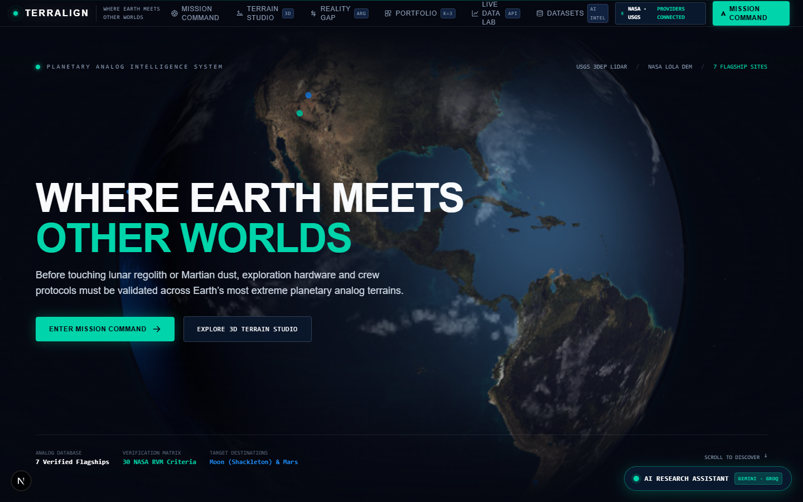
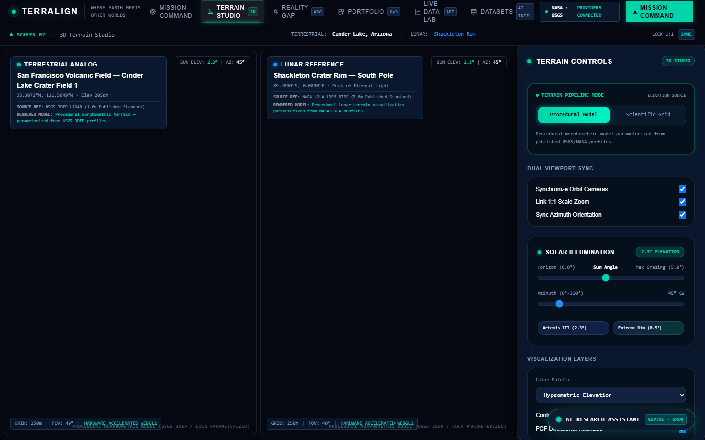
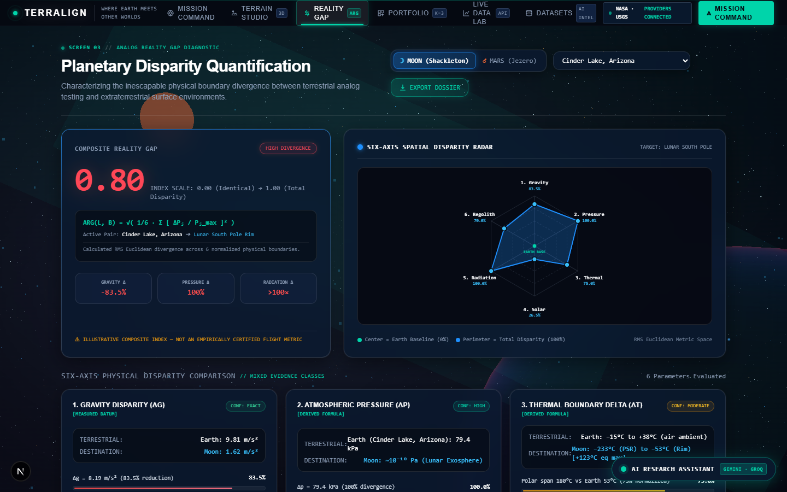
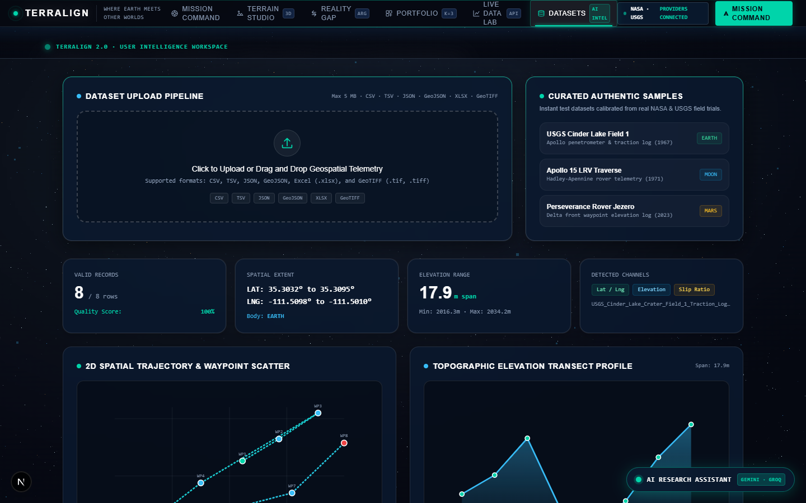
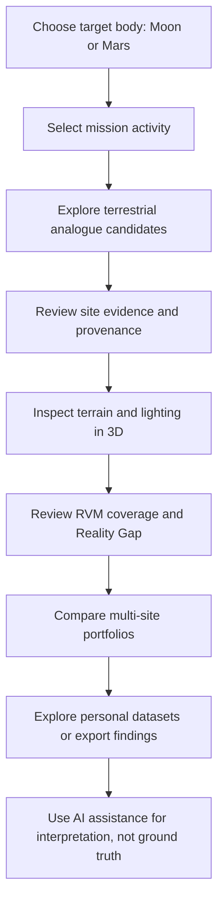
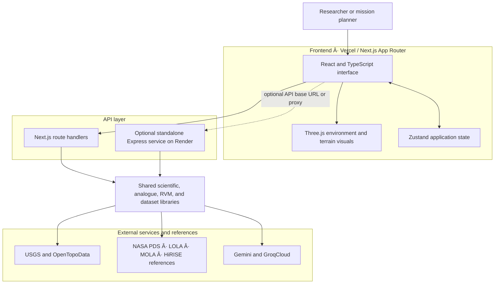

<div align="center">

# TERRALIGN 2.0

### Where Earth Meets Other Worlds

**An evidence-aware planetary analogue intelligence platform for lunar and Martian mission research.**

[](https://terralign-green.vercel.app)
[](https://github.com/selfabhijeetkumar/terralign)




*Explore Earth-based analogue landscapes through the lens of future lunar and Martian missions.*

</div>

---

## Contents

- [Mission brief](#mission-brief)
- [Explore the experience](#explore-the-experience)
- [What TERRALIGN does](#what-terralign-does)
- [How it works](#how-it-works)
- [Scientific data and provenance](#scientific-data-and-provenance)
- [Personal dataset support](#personal-dataset-support)
- [AI-assisted research and disclosure](#ai-assisted-research-and-disclosure)
- [Architecture](#architecture)
- [Technology stack](#technology-stack)
- [Run locally](#run-locally)
- [Deployment and project links](#deployment-and-project-links)
- [Reported validation snapshot](#reported-validation-snapshot)
- [Team NEXARC](#team-nexarc)
- [Acknowledgements](#acknowledgements)

---

## Mission brief

Future lunar and Martian missions need places on Earth where teams can rehearse activities, investigate terrain, evaluate equipment, and understand operational constraints. Yet **no terrestrial environment is an exact replica of another world**. Differences in gravity, atmosphere, radiation, temperature, regolith behavior, and weathering limit what Earth-based analogues can represent.

TERRALIGN helps researchers discover and compare terrestrial analogue environments for mission-specific use cases while keeping the limits of each comparison visible. It brings together a curated analogue knowledge base, planetary topographic references, 3D terrain exploration, a Requirement Verification Matrix (RVM), Reality Gap diagnostics, portfolio comparison, personal dataset analysis, and AI-assisted interpretation.

> **Core principle:** resemblance is not equivalence. TERRALIGN communicates where an analogue may be useful, what evidence supports the comparison, and which extraterrestrial conditions remain unmatched.

**NASA Space Apps Challenge problem context:** “Discovery and Characterization of New Terrestrial Analogs for Lunar and Martian Exploration.”

TERRALIGN is an independent student project created for the NASA Space Apps Challenge. It is **not an official NASA product**, and NASA does not endorse it.

---

## Explore the experience

The screenshots below are application captures stored in the repository. Each illustrates a different part of the TERRALIGN experience.

<table>
<tr>
<td width="50%" valign="top">
  <a href="docs/design/screenshots/cosmic-mission-1440-scroll0.png"></a>
  <strong>01 · Mission Command</strong><br>
  Choose a target world and mission activity, explore analogue candidates, and inspect site context.
</td>
<td width="50%" valign="top">
  <a href="docs/design/screenshots/cosmic-terrain-1440-scroll0.png"></a>
  <strong>02 · Terrain Studio</strong><br>
  Compare Earth and extraterrestrial terrain representations in synchronized 3D viewports.
</td>
</tr>
<tr>
<td width="50%" valign="top">
  <a href="docs/design/screenshots/cosmic-reality-gap-1440-scroll0.png"></a>
  <strong>03 · Reality Gap</strong><br>
  Review mission-relevant differences across physical and operational dimensions.
</td>
<td width="50%" valign="top">
  <a href="docs/design/screenshots/cosmic-portfolio-1440-scroll0.png"></a>
  <strong>04 · Portfolio Optimizer</strong><br>
  Compare combinations of analogue sites using the RVM coverage framework.
</td>
</tr>
<tr>
<td width="50%" valign="top">
  <a href="docs/design/screenshots/cosmic-live-data-1440-scroll0.png"></a>
  <strong>05 · Live Data Lab</strong><br>
  Query supported elevation sources, inspect transects, browse datasets, and review provider status.
</td>
<td width="50%" valign="top">
  <a href="docs/design/screenshots/cosmic-datasets-1440-scroll0.png"></a>
  <strong>06 · Dataset Manager</strong><br>
  Upload and inspect supported geospatial and tabular files.
</td>
</tr>
</table>

### Cosmic Ascension visual system

The interface also features a persistent procedural space environment, reusable luminous panel treatments, a subtle card-shine sweep, and a custom celestial-dragon pointer effect on supported desktop devices.

<div align="center">
  
  <br><em>Celestial Dragon Cursor · Procedural Canvas2D rendering</em>
</div>

Additional captures: [desktop home, scroll 50](docs/design/screenshots/cosmic-home-1440-scroll50.png) · [desktop home footer](docs/design/screenshots/cosmic-home-1440-scroll100.png) · [mobile home](docs/design/screenshots/cosmic-home-390.png) · [mobile Live Data Lab](docs/design/screenshots/cosmic-live-data-390.png).

---

## What TERRALIGN does

| Capability | What it helps a researcher do |
|---|---|
| **Mission-specific analogue discovery** | Filter and rank terrestrial landscapes for activities such as rover mobility, EVA operations, low-angle lighting studies, cryogenic drilling, lava-tube exploration, fluvial science, landing-hazard analysis, and ISRU research. |
| **3D Terrain Studio** | Explore topographic form, lighting, slopes, and morphology through interactive 3D comparisons. |
| **Reality Gap diagnostics** | Keep important Earth-to-Moon/Mars physical differences visible instead of treating analogue similarity as equivalence. |
| **Requirement Verification Matrix (RVM)** | Review requirement coverage across individual sites and multi-site portfolios. |
| **Portfolio Optimizer** | Compare candidate site combinations and the additional requirement coverage they contribute. |
| **Live Data Lab** | Query supported elevation services, inspect elevation transects, browse planetary datasets, and check provider availability. |
| **Personal Dataset Manager** | Upload supported geospatial and tabular files and inspect metadata, spatial bounds, elevation summaries, and data quality. |
| **AI Research Assistant** | Ask research questions and receive AI-assisted explanations with model and provenance disclosures. |

## How it works

A researcher selects a target world and mission activity, then explores candidate terrestrial sites and the evidence available for each comparison. Terrain views, requirement coverage, and Reality Gap diagnostics help make both potential usefulness and important differences visible. Portfolio comparison can show how a set of sites contributes to requirements. AI assistance can help explain or synthesize information, but it is not ground truth.



---

## Scientific data and provenance

TERRALIGN represents a combination of provider-backed point queries, archived planetary products, curated reference values, and calibrated or procedural models. These categories are not interchangeable: a provider query, a product catalogue entry, a static reference, and a generated terrain model have different evidentiary status.

| Body or domain | Provider or product | Use represented in TERRALIGN |
|---|---|---|
| **Earth** | [USGS 3DEP](https://www.usgs.gov/3d-elevation-program) and [Elevation Point Query Service](https://epqs.nationalmap.gov/) | Supported point-elevation queries for US coverage, including selected high-resolution requests. |
| **Earth** | [USGS National Elevation Dataset (NED)](https://www.usgs.gov/3d-elevation-program) via [OpenTopoData](https://www.opentopodata.org/) | Supported elevation queries and terrestrial analogue reference points. |
| **Earth** | [NASA SRTM 1-arc-second / 30 m product](https://www.earthdata.nasa.gov/data/instruments/srtm) via OpenTopoData | Global elevation fallback or reference where supported by the provider chain. |
| **Moon** | [NASA Lunar Reconnaissance Orbiter (LRO) Lunar Orbiter Laser Altimeter (LOLA)](https://pds-geosciences.wustl.edu/lro/lro-l-lola-3-rdr-v1/) | Lunar topographic product catalogue and PDS Orbital Data Explorer metadata discovery; the current point-elevation model is labelled as a static reference. |
| **Mars** | [NASA Mars Global Surveyor (MGS) Mars Orbiter Laser Altimeter (MOLA)](https://pds-geosciences.wustl.edu/mgs/mgs-m-mola-5-megdr-l3-v1/) | Martian topographic product reference and calibrated elevation-model context. |
| **Mars** | [NASA Mars Reconnaissance Orbiter (MRO) HiRISE Digital Terrain Models](https://www.uahirise.org/dtm/) | Targeted high-resolution terrain product references, including Jezero-related context. |

Additional catalogue and source references:

- [NASA Planetary Data System (PDS)](https://pds.nasa.gov/)
- [PDS Geosciences Node Orbital Data Explorer](https://oderest.rsl.wustl.edu/live2/)
- [OpenTopoData](https://www.opentopodata.org/)

### Important scientific limitations

- **Earth elevation:** provider-backed queries may return live data, cached data, or a static reference fallback. Check the epistemic status and source metadata associated with each result.
- **Moon and Mars elevation:** NASA product metadata discovery is not the same as retrieving a raw, live altimeter measurement for every coordinate. The current Moon/Mars point-elevation logic includes calibrated or static reference models.
- **3D terrain grids:** the current terrain-grid implementation is labelled **`CALIBRATED MORPHOMETRIC SYNTHESIS`**. It is a generated morphometric model anchored to a point reference—not a raw DEM tile or direct spacecraft telemetry.
- **Analogue interpretation:** an Earth site may be useful for a specific rehearsal while still being physically different from the Moon or Mars.
- **Alignment index:** the displayed **`MODEL-ASSESSED / HEURISTIC ALIGNMENT INDEX`** is not scientific validation, experimental proof, or an independent measurement of physical similarity.

These distinctions are part of TERRALIGN’s scientific-integrity approach.


## Personal dataset support

The Dataset Manager accepts the following formats:

| Format | Extensions |
|---|---|
| Comma-separated values | `.csv` |
| Tab-separated values | `.tsv` |
| JavaScript Object Notation | `.json` |
| Geographic JSON | `.geojson` |
| Excel workbook | `.xlsx` |
| GeoTIFF raster | `.tif`, `.tiff` |

The parser enforces a **5 MB upload limit** and applies additional validation to workbook and raster inputs. Macro-enabled `.xlsm` files are rejected. Uploaded files are treated as user-provided data and should not be confused with TERRALIGN’s curated scientific references.

---

## AI-assisted research and disclosure

The documented deployment configuration integrates:

| Service | Configured model |
|---|---|
| Google Gemini | `gemini-2.5-flash` |
| GroqCloud | `openai/gpt-oss-120b` |

The AI Research Assistant supports research-oriented explanation and comparative synthesis. TERRALIGN also exposes a model-assessed/heuristic alignment index that combines a calculated slip-difference component with structured heuristic baseline dimensions. It must not be interpreted as experimentally validated scientific consensus.

AI responses are assistance for exploration and interpretation. They do not replace primary datasets, citations, field measurements, or expert review.

AI tools were used as development aids: Antigravity IDE agent, OpenAI ChatGPT, Claude, and GPT-6 Luna supported implementation planning, code generation and refinement, debugging, visual-design prompt development, technical review, and documentation. AI-assisted code and generated explanations are reviewed against application requirements and available source data; they are not treated as scientific ground truth.

The visual environment and cursor effects are procedural software-rendered effects, and the screenshots in this repository are captures of the application interface. If AI-generated images, video, or audio are added to the final submission, identify them as AI-generated in accordance with the event’s instructions. Do not use, reproduce, or modify NASA logos, insignia, mission patches, or other NASA branding in AI-generated material.

---

## Architecture

The Vercel-hosted Next.js application can serve its native API routes. The repository also includes an optional standalone Express service and a Render Blueprint. Production traffic should not be described as routed through Render unless that service has been activated and its URL configured.



---

## Technology stack

| Layer | Technologies |
|---|---|
| Web application | Next.js App Router, React 19, TypeScript |
| Styling | Tailwind CSS 3, CSS custom properties |
| 3D rendering | Vanilla Three.js, procedural geometry and shaders |
| Client state | Zustand |
| Optional backend | Express 5, Node.js, `tsx` |
| Geospatial processing | GeoTIFF parser, XLSX parser, custom CSV/TSV/JSON/GeoJSON processing |
| AI services | Google Gemini, GroqCloud |
| Hosting | Vercel; optional Render Blueprint for the standalone API service |

---

## Run locally

### Prerequisites

- Node.js compatible with the repository’s configured runtime (Node 24 was used for the reported release validation)
- pnpm
- Git

### Install and start

```bash
git clone https://github.com/selfabhijeetkumar/terralign.git
cd terralign
pnpm install
```

Create a local environment file from the example:

```bash
cp .env.local.example .env.local
```

Add provider credentials only to your local `.env.local` file or a secure secret manager. **Do not commit this file or expose provider keys through `NEXT_PUBLIC_` variables.**

```env
GEMINI_API_KEY=your_server_side_gemini_key
GEMINI_MODEL=gemini-2.5-flash
GROQ_API_KEY=your_server_side_groq_key
GROQ_MODEL=openai/gpt-oss-120b
```

Start the Next.js application:

```bash
pnpm dev
```

Open [http://localhost:3000](http://localhost:3000).

### Optional standalone backend

The repository includes a Render-compatible Express service:

```bash
pnpm start:server
```

The service exposes a health endpoint at `/health`. For local development, configure the frontend API base URL only if you intentionally want to use the standalone service; otherwise, the Next.js application can use its same-origin API routes.

### Useful commands

```bash
pnpm dev                 # Start the Next.js development server
pnpm build               # Create a production build
pnpm start               # Start the built Next.js application
pnpm start:server        # Start the standalone Express API service
pnpm exec tsc --noEmit   # Run TypeScript validation
```

---

## Deployment and project links

| Resource | Link or note |
|---|---|
| **Live application** | [terralign-green.vercel.app](https://terralign-green.vercel.app) |
| **Source repository** | [github.com/selfabhijeetkumar/terralign](https://github.com/selfabhijeetkumar/terralign) |
| **Optional Render Blueprint** | [`render.yaml`](render.yaml) |

The submitted deployment report records the Vercel frontend as live. The Render Blueprint is included for optional standalone backend activation. Before routing production traffic through Render, deploy the Blueprint, add the required server-side secrets in the Render dashboard, and configure the actual Render service URL in Vercel. Never put secrets in this README or in public client-side environment variables.

For project questions or collaboration, use the [GitHub repository](https://github.com/selfabhijeetkumar/terralign).

---

## Reported validation snapshot

The project release and visual-enhancement reports record the following results for the tested revision:

- **67/67** automated regression assertions passed across six suites.
- TypeScript check completed with zero reported errors.
- Next.js production build completed successfully; 19 static-generation tasks and 24 route-table entries were reported.
- Scientific DOM snapshots were compared across seven primary routes. The verification report contains length differences while also reporting sample matches; this README does **not** claim byte-for-byte DOM identity.
- The Cosmic Ascension hotfix addressed a negative Canvas2D particle radius and released the shared cosmic WebGL context when entering `/terrain`.
- Direct GPU frame time was not verified in the reported headless-browser environment.

These are implementation-reported results for the release revision, not a guarantee that every external data provider or live AI account is continuously available.

---

## Team NEXARC

| Team member | Team role |
|---|---|
| **Abhijeet Kumar** | Team Lead |
| **Vaishnavi Isrannavar** | Team Member |

Personal phone numbers and personal email addresses are intentionally not published.

---

## Acknowledgements

TERRALIGN references open planetary and terrestrial data products and documentation from NASA’s Planetary Data System, USGS, and associated scientific data providers. Consult each provider’s citation and usage guidance when reusing data or reproducing analyses.

This is an independent student project created for the NASA Space Apps Challenge. **It is not an official NASA product, and NASA does not endorse this project.**

---

<div align="center">

**TERRALIGN 2.0 · NEXARC**  
*Where Earth Meets Other Worlds.*

[Launch TERRALIGN](https://terralign-green.vercel.app) · [Explore the source code](https://github.com/selfabhijeetkumar/terralign)

</div>
