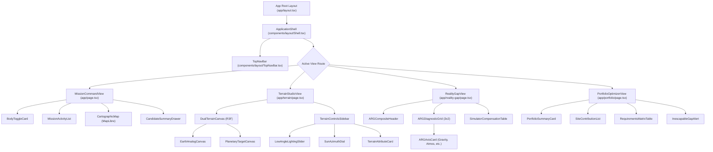

# TERRALIGN Component Architecture

> **Phase**: Phase 2 — Product Design & Architecture  
> **Status**: Approved Component Specification  
> **Target Framework**: React 19 / Next.js 15 App Router

---

## 1. Component Tree & Hierarchy

The component hierarchy is decomposed into four functional layers: Layout Shell, View Containers, Scientific Feature Modules, and UI Primitives.

---

## 2. Component Contract & Interface Inventory

### 2.1 Viewport Components
- **`DualTerrainCanvas`**:
  - `props`: `{ earthSiteId: string, planetaryFeatureId: string, sunElevation: number, sunAzimuth: number, syncCameras: boolean }`
  - `emits`: `onCameraChange(cameraState: CameraTransform)`
- **`TerrainControlsSidebar`**:
  - `props`: `{ activeLayers: TerrainLayerConfig, lightingState: LightingConfig, attributes: TerrainAttributes }`
  - `emits`: `onLightingChange(elevation: number, azimuth: number)`, `onLayerToggle(layer: string)`

### 2.2 Scientific Assessment Components
- **`ARGAxisCard`**:
  - `props`: `{ axisKey: ARGAxisKey, earthValue: PhysicalValue, planetaryValue: PhysicalValue, divergence: number, confidence: ConfidenceLevel, caveat?: string }`
- **`RequirementsMatrixTable`**:
  - `props`: `{ requirements: MissionRequirement[], selectedSiteIds: string[], threshold: number, activeDomainFilter: string }`
  - `emits`: `onThresholdChange(theta: number)`, `onSiteToggle(siteId: string)`

### 2.3 Shared UI Primitives
- **`ConfidenceBadge`**: Color-coded pill (`EXACT`, `HIGH`, `MODERATE`, `LOW`, `UNCHARACTERIZED`).
- **`DivergenceBar`**: Gradient progress bar ($0\%$ to $100\%$) indicating physical reality gap.
- **`MonospaceMetric`**: Accessible container rendering values in Space Mono with physical unit suffixes.
- **`ProvenanceTooltip`**: Clickable tooltip displaying dataset name, acquiring instrument, and DOI.

