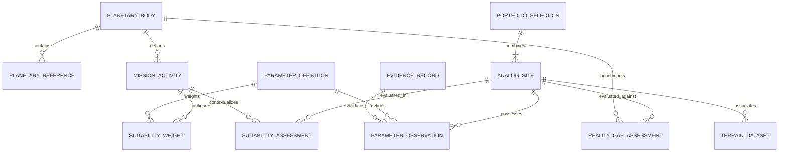

# TERRALIGN Conceptual Data Model & Entity Relationships

> **Phase**: Phase 2 — Product Design & Architecture  
> **Status**: Approved Conceptual Data Model  
> **Implementation**: TypeScript Interfaces & Static JSON Schemas (Phase 3)

---

## 1. Entity-Relationship Diagram (ERD)

---

## 2. Core Entity Definitions

### 2.1 `AnalogSite`
- **Purpose**: Represents a characterized terrestrial planetary analog environment.
- **Attributes**:
  - `id`: Unique slug (`"cinder-lake"`, `"atacama-yungay"`).
  - `name`: Display name (`"Cinder Lake Crater Field"`).
  - `region`: Administrative & geographical region (`"San Francisco Volcanic Field, AZ, USA"`).
  - `latitude`: WGS84 Decimal Latitude (`35.3489`).
  - `longitude`: WGS84 Decimal Longitude (`-111.5145`).
  - `elevationMeters`: Elevation relative to sea level (`2130`).
  - `primaryGeology`: Dominant lithology (`"Basaltic Cinder"`).
  - `climateZone`: Köppen-Geiger class (`"BSk - Semi-Arid Volcanic Plateau"`).
  - `flagshipStatus`: Boolean indicating verified benchmark status (`true`).

### 2.2 `MissionActivity`
- **Purpose**: A specific operational surface exploration activity on the Moon or Mars.
- **Attributes**:
  - `id`: Activity slug (`"rover_terramechanics"`).
  - `name`: Full title (`"Rover Terramechanics & Mobility"`).
  - `targetBody`: `"moon"` | `"mars"`.
  - `description`: Operational objectives and physical challenges.
  - `safetyCritical`: Boolean indicating if mission-critical flight rules apply.

### 2.3 `ParameterObservation`
- **Purpose**: An empirical ground-truth measurement recorded at an analog site.
- **Attributes**:
  - `siteId`: Reference to `AnalogSite`.
  - `parameterId`: Reference to `ParameterDefinition` (`"mean_slope"`, `"perchlorate_wt_pct"`).
  - `measuredValue`: Numeric or categorical reading.
  - `unit`: Physical SI unit (`"deg"`, `"wt%"`, `"m/s²"`, `"kPa"`).
  - `evidenceId`: Reference to `EvidenceRecord` (DOI, publication).
  - `confidence`: Enum (`"EXACT"`, `"HIGH"`, `"MODERATE"`, `"LOW"`, `"UNCHARACTERIZED"`).

### 2.4 `TerrainDataset`
- **Purpose**: Digital elevation and spatial data associated with a site.
- **Attributes**:
  - `datasetId`: Unique identifier (`"cinder-lake-3dep-1m"`).
  - `source`: Dataset provider (`"USGS 3DEP"`, `"NASA PDS LOLA"`).
  - `spatialResolutionMeters`: Horizontal resolution (`1.0`).
  - `verticalAccuracyMeters`: Vertical margin (`0.15`).
  - `heightmapTileUrl`: Path to preprocessed 16-bit PNG tile.
  - `tileBounds`: Bounding box `[minLon, minLat, maxLon, maxLat]`.

### 2.5 `EvidenceRecord`
- **Purpose**: Verifiable citation proving scientific provenance.
- **Attributes**:
  - `id`: Unique citation key (`"usgs-ofr-68-24"`).
  - `title`: Document title (`"Field Geologic Traverses: Cinder Lake Crater Field"`).
  - `author`: Lead author or agency (`"USGS Astrogeology Branch"`).
  - `year`: Publication year (`1968`).
  - `doi`: Digital Object Identifier string (`"10.5066/P9XYZ890"`).
  - `url`: Direct resolver link (`"https://doi.org/10.5066/P9XYZ890"`).
  - `license`: Data reuse terms (`"U.S. Public Domain"`).

