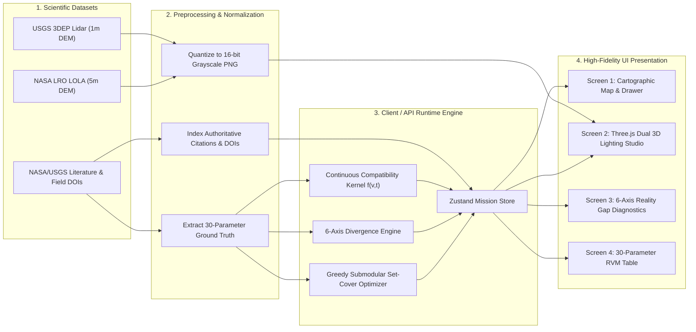

# TERRALIGN Data Flow & State Lifecycle

> **Phase**: Phase 2 — Product Design & Architecture  
> **Status**: Approved Data Architecture

---

## 1. End-to-End Scientific Data Pipeline



---

## 2. Zustand Client State Management Schema

The entire application state is governed by a lightweight, reactive Zustand store partitioned into four slices:

```typescript
interface TerralignAppState {
  // Mission Configuration Slice
  mission: {
    targetBody: "moon" | "mars";
    activeActivity: string; // e.g. "rover_terramechanics"
    filters: {
      geologyType?: string;
      geomorphology?: string;
      climateZone?: string;
      minResolutionMeters?: number;
    };
  };
  
  // Selection Slice
  selection: {
    selectedSiteId: string; // default: "cinder-lake"
    comparisonSiteIds: string[]; // for portfolio k=3
    activePlanetaryFeature: string; // default: "shackleton-rim"
  };
  
  // 3D Terrain Studio Slice
  terrain: {
    syncCameras: boolean;
    syncRotation: boolean;
    linkZoom: boolean;
    colorMode: "hypsometric" | "slope" | "aspect" | "raw";
    showHillshade: boolean;
    showContours: boolean;
    sunElevationDeg: number; // 0.0 to 5.0
    sunAzimuthDeg: number;   // 0 to 360
    cameraTransform: {
      position: [number, number, number];
      target: [number, number, number];
    };
  };
  
  // Portfolio Optimizer Slice
  portfolio: {
    targetK: 2 | 3;
    fidelityThreshold: number; // default: 0.70
    activeDomainFilter: "all" | "mechanical" | "optical" | "geochemical" | "environmental";
  };
  
  // Actions
  setTargetBody: (body: "moon" | "mars") => void;
  setActiveActivity: (activity: string) => void;
  selectSite: (siteId: string) => void;
  setSunLighting: (elevation: number, azimuth: number) => void;
  setPortfolioK: (k: 2 | 3) => void;
}
```

