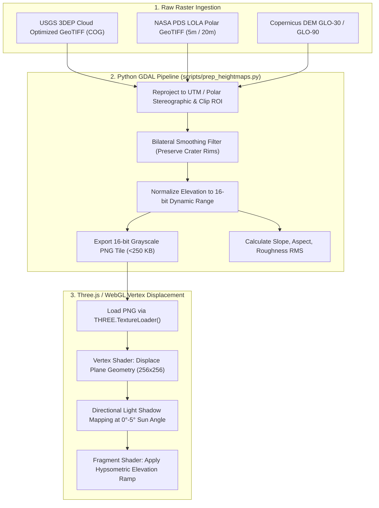

# TERRALIGN Geospatial Processing Pipeline

> **Phase**: Phase 2 — Product Design & Architecture  
> **Status**: Approved Processing Specification  
> **Toolchain**: Python / GDAL / Rasterio (Offline) + WebGL / Shaders (Client)

---

## 1. Topographic Data Pipeline Architecture

---

## 2. Quantized Heightmap Specification

To guarantee $<2.0\text{s}$ load times and steady $60\text{ FPS}$ rendering without streaming gigabyte GeoTIFFs:
1. **Format**: 16-bit Grayscale PNG (`uint16`).
2. **Resolution**: $256 \times 256$ pixels (1 pixel = $1.0\text{m}$ for USGS, $5.0\text{m}$ for LOLA).
3. **Payload Size**: $180\text{ KB}\text{--}240\text{ KB}$ per tile (compressed).
4. **Elevation Mapping**:
   $$z(u, v) = z_{\min} + \left( \frac{\text{pixel\_value}(u, v)}{65535} \right) \cdot (z_{\max} - z_{\min})$$
   Where $z_{\min}$ and $z_{\max}$ are embedded in tile metadata JSON.

---

## 3. Directional Shadow Simulation Shader
On the lunar South Pole viewport, shadows are rendered via standard Three.js directional PCF soft shadow maps with zero ambient fill light (`ambientIntensity = 0.02`), accurately capturing the optical challenge of non-diffuse vacuum shadow traversal.

