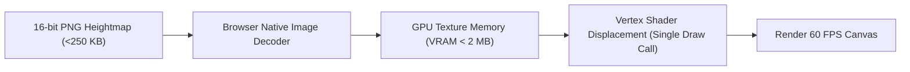

# TERRALIGN Performance, Profiling & Scalability Architecture

> **Phase**: Phase 2 — Product Design & Architecture  
> **Status**: Approved Performance Specification  
> **Claim Classification**: `[C]` Research-Backed Architectural Target

---

## 1. Architectural Performance Targets

All figures listed below are formal **Architectural Targets `[C]`** established during Phase 1/Phase 2 design. Empirical verification will occur in Phase 4 using automated Lighthouse and WebGL frame profiling.

| Metric | Target Specification | Design Strategy / Mitigation |
|:---|:---:|:---|
| **Initial Page Load (FCP)** | $< 1.2\text{ s}$ | Next.js 15 Server-Side Rendering (SSR) of layout shell and text content. |
| **Time to Interactive (TTI)** | $< 2.0\text{ s}$ | Lazy loading of Three.js canvas and MapLibre engine until viewport entered. |
| **Heightmap Tile Transfer** | $< 250\text{ KB}$ per tile | 16-bit grayscale PNG compression ($256 \times 256$ pixels). |
| **WebGL Frame Rate** | Stable $60\text{ FPS}$ | Compact geometry ($256 \times 256$ plane = 65k vertices), hardware vertex shader displacement. |
| **Portfolio Optimizer Execution** | $< 10\text{ ms}$ | Pure client-side greedy submodular optimization across $7$ sites $\times 30$ parameters. |
| **Total JavaScript Bundle** | $< 350\text{ KB}$ gzip | Code splitting, dynamic imports (`next/dynamic`) for Three.js. |

---

## 2. WebGL Performance Budget & Optimization Strategy

1. **Geometry Reuse**: Single `THREE.PlaneGeometry(500, 500, 255, 255)` instance instantiated once and reused across site changes.
2. **Texture Swapping**: Updating terrain only requires swapping the sampler2D heightmap uniform in the material shader, eliminating mesh rebuild garbage collection.
3. **Power Preference**: Three.js WebGLRenderer initialized with `{ powerPreference: "high-performance", antialias: true }`.

