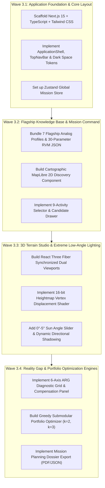

# TERRALIGN Phase 3 Implementation Plan & Engineering Contract

> **Phase**: Phase 2 — Product Design & Architecture (Deliverable to Phase 3)  
> **Status**: Approved Implementation Plan  
> **Governance**: Ponytail FULL (`REUSE → SIMPLIFY → IMPLEMENT`)

---

## 1. Phase 3 Scope & Execution Waves

Phase 3 converts the verified Phase 1 research and Phase 2 design specifications into a working, high-fidelity Next.js 15 application.

---

## 2. Detailed Task Breakdown & Acceptance Criteria

### Wave 3.1: Foundation & Layout
- **Task 3.1.1**: Initialize Next.js 15 with App Router, TypeScript, and Tailwind CSS. Apply `#050811`, `#0A192F`, `#00D4AA`, and Space Grotesk/Space Mono typography tokens.
  - *Acceptance Criteria*: Zero build errors (`npm run build`), WCAG AA contrast maintained.
- **Task 3.1.2**: Implement `ApplicationShell` and `TopNavBar` with working tab navigation across the 4 screens.
- **Task 3.1.3**: Configure Zustand store `useMissionStore.ts` with target body, activity selection, and terrain controls.

### Wave 3.2: Mission Command & 2D Discovery (Screen 1)
- **Task 3.2.1**: Create `data/analogs.json` with ground-truth records for all 7 flagship sites (Atacama, McMurdo, Askja, Hawaii, Cinder Lake, Utah, Devon Island).
- **Task 3.2.2**: Integrate MapLibre GL displaying global site markers with glowing reticles and coordinates.
- **Task 3.2.3**: Build `CandidateSummaryDrawer` with 5-dimension suitability score breakdown and `ConfidenceBadge`.

### Wave 3.3: 3D Terrain Studio (Screen 2)
- **Task 3.3.1**: Build `DualTerrainCanvas` using `@react-three/fiber` rendering synchronized side-by-side viewports.
- **Task 3.3.2**: Implement vertex shader displacing plane geometry using preprocessed 16-bit PNG heightmaps for Cinder Lake (USGS 3DEP) and Shackleton Crater (LRO LOLA).
- **Task 3.3.3**: Connect `LowAngleLightingSlider` ($0.0^\circ\text{--}5.0^\circ$) casting real-time raytraced shadows across crater rims.

### Wave 3.4: Reality Gap & Portfolio Optimizer (Screens 3 & 4)
- **Task 3.4.1**: Build `RealityGapDiagnosticView` rendering the 6-axis gap grid ($\text{ARG} = 0.72$) and proposed experimental compensation table.
- **Task 3.4.2**: Implement `portfolioOptimizer.ts` executing greedy submodular set-cover across 30 RVM requirements, displaying $78.4\%$ empirical coverage for $k=3$.
- **Task 3.4.3**: Implement client-side Mission Dossier download.

---

## 3. Implementation Guardrails & Ponytail Rules
1. **No Speculative Complexities**: Do not implement user login, cloud database subscriptions, or WebXR unless explicitly requested.
2. **Honesty-First Code**: If a site lacks ground truth for an activity, the engine must return `uncertainty: true` and assign the neutral $0.5$ heuristic with bounds $[S_{\min}, S_{\max}]$.
3. **Commit Discipline**: Atomic commits per completed plan using descriptive conventional commit messages.

