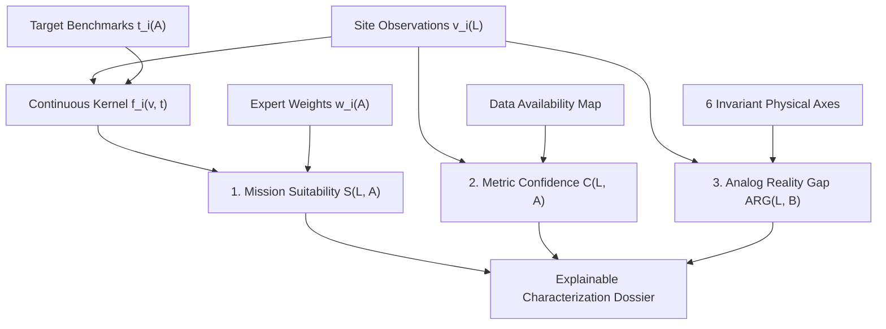

# TERRALIGN Scientific Assessment Engine

> **Phase**: Phase 2 — Product Design & Architecture  
> **Status**: Approved Mathematical Formulation & Module Architecture  
> **Governance**: Zero Arbitrary Weights · Full Algorithmic Explainability

---

## 1. Mathematical Scoring Engine Specification

The evaluation engine computes three independent scientific metrics for any analog candidate site $L$ and operational mission activity $A$:

---

## 2. Mathematical Formulations

### 2.1 The Normalized Mission Suitability Score ($S$)
$$S(L, A) = \sum_{i=1}^{m} w_i(A) \cdot f_i(v_i(L), t_i(A)) \cdot (1 - \text{Penalty}_i)$$

Where continuous compatibility $f_i$ is governed by a Gaussian decay kernel:
$$f_i(v, t) = \exp\left( - \frac{(v - t)^2}{2\sigma_i^2} \right)$$

### 2.2 Metric Confidence Score ($C$) & Missing-Data Handling
$$C(L, A) = \frac{\sum_{i \in \text{Measured}} w_i(A)}{\sum_{i=1}^{m} w_i(A)}$$

- **Unvalidated Heuristic Assumption**: For unmeasured, non-critical parameters, $f_i = 0.5$ is assigned as an imputation baseline.
- **Uncertainty Bounds**: The engine computes sensitivity bounds $[S_{\min}, S_{\max}]$:
  $$S_{\min}(L, A) = \sum_{i \in \text{Measured}} w_i f_i + \sum_{i \in \text{Missing}} w_i \cdot 0.0$$
  $$S_{\max}(L, A) = \sum_{i \in \text{Measured}} w_i f_i + \sum_{i \in \text{Missing}} w_i \cdot 1.0$$
- If spread $\Delta S = S_{\max} - S_{\min} > 0.25$, the single-point score is marked invalid for flight qualification.

### 2.3 The Analog Reality Gap (ARG) Index
$$\text{ARG}(L, B) = \sqrt{\frac{1}{6} \sum_{j=1}^{6} \left( \frac{\Delta P_j}{P_{j,\text{max}}} \right)^2}$$

Governed across the 6 physical axes: Gravity ($g$), Pressure ($p$), Temperature span ($\Delta T$), Solar Irradiance ($I$), Radiation ($R$), and Regolith cohesion ($C$).

### 2.4 Multi-Site Portfolio Optimizer (Greedy Submodular Set-Cover)
Given $R = \{r_1, \dots, r_{30}\}$ and $\mathcal{L} = \{L_1, \dots, L_7\}$:
1. Initialize portfolio $\mathcal{S} = \emptyset$.
2. Iteratively select $L^* = \arg\max_{L \in \mathcal{L} \setminus \mathcal{S}} \left| \text{Covered}(\mathcal{S} \cup \{L\}) \right|$.
3. Terminate when $|\mathcal{S}| = k$ ($k \in \{2, 3\}$).
4. Return empirical coverage percentage and flag the inescapable physics gaps.

