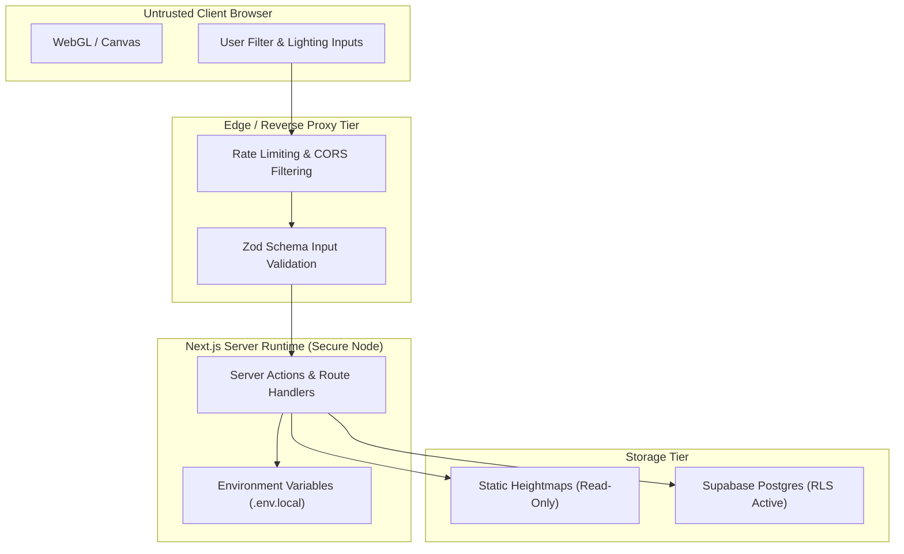

# TERRALIGN Security & Data Governance Architecture

> **Phase**: Phase 2 — Product Design & Architecture  
> **Status**: Approved Security Specification  
> **Target Standard**: OWASP Top 10 Compliance · Zero Hardcoded Secrets

---

## 1. Threat Model & Security Boundaries

TERRALIGN handles scientific mission planning and geospatial dataset access. While non-classified, maintaining data provenance integrity and preventing infrastructure compromise are vital.

---

## 2. Core Security Controls

1. **Zero Credential Exposure**:
   - Zero API keys, tokens, or service role credentials exist in the client-side bundle or Git history.
   - All external calls (e.g. Supabase, USGS) originate server-side from Next.js route handlers.
2. **Strict Input Sanitization**:
   - Every API endpoint validates payloads using Zod schemas (`zod`). Unrecognized parameters, path traversal attacks (`../`), and invalid numeric ranges are rejected with HTTP 400.
3. **Static Elevation Asset Protection**:
   - Quantized PNG heightmaps are served read-only from the application public directory. Write operations are strictly disallowed.
4. **Content Security Policy (CSP)**:
   - Restricts script execution to self, enforces HTTPS, and limits WebGL canvas origins to MapLibre and local assets.

