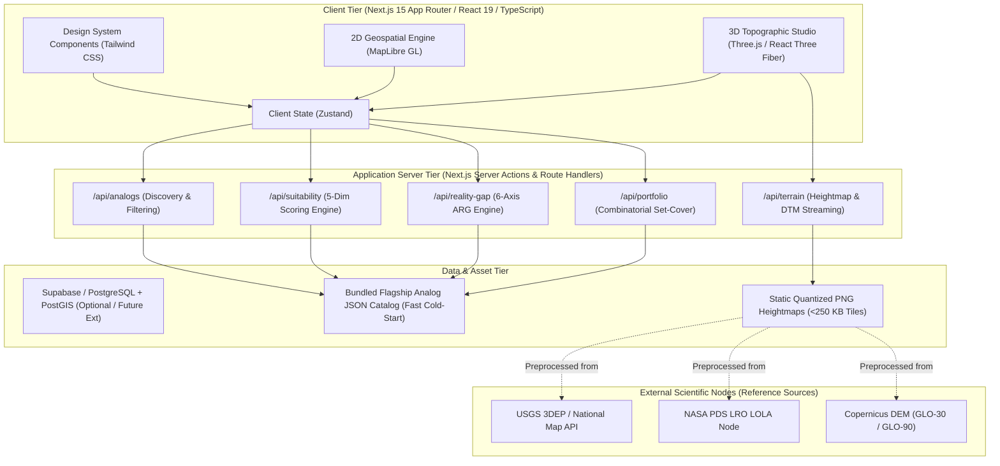

# TERRALIGN System Architecture

> **Version**: 1.0.0  
> **Phase**: Phase 2 — Product Design & Architecture  
> **Status**: Approved Architectural Baseline  
> **Governance**: Ponytail FULL (`REUSE → SIMPLIFY → IMPLEMENT`)

---

## 1. High-Level Architecture Overview

TERRALIGN follows a modern, modular, decoupled web application architecture designed for responsive scientific visualization and mission planning.

---

## 2. Architectural Principles & Ponytail Governance

1. **Static / Bundled First (Zero Dependency Fragility)**:
   - For hackathon demonstration and fast cold starts, the 7 flagship analog site profiles, their 30 RVM parameters, and the quantized heightmap tiles are bundled directly in the application repository.
   - Eliminates reliance on external live API uptime during live presentations.
2. **Deterministic Scientific Calculation**:
   - The 5-dimensional suitability scoring model, 6-axis ARG formulation, and greedy submodular portfolio optimizer are pure, deterministic functions implemented in TypeScript.
   - LLMs are **never** used to generate or modify scientific scores.
3. **Decoupled 3D Rendering**:
   - The Three.js WebGL canvas communicates exclusively through declarative props and a shared Zustand state slice.
   - Shaders operate on standard $256 \times 256$ 16-bit displacement textures, ensuring $60\text{ FPS}$ stability on standard integrated laptop GPUs.
4. **Platform & IDE Independence**:
   - All code follows standard POSIX path conventions, runs seamlessly under Node.js 20+/24+ on Windows, macOS, or Linux, and contains zero IDE-specific lock-in.

---

## 3. Technology Stack Selection & Justification

| Layer | Selected Technology | Version | Rationale & Alternatives Rejected |
|:---|:---|:---:|:---|
| **Framework** | Next.js (App Router) | `15.x` | React Server Components for fast initial loads; built-in API route handlers; zero boilerplate. |
| **Language** | TypeScript | `5.x` | Strict typing for scientific parameters, physical units, and coordinate systems. |
| **Styling** | Tailwind CSS | `3.4 / 4.x` | Utility-first tokens matching the TERRALIGN Dark Space design system. |
| **2D Mapping** | MapLibre GL | `4.x` | Free, open-source fork of Mapbox GL; WebGL hardware acceleration; zero telemetry or licensing costs. (Rejected Cesium: too heavy for 2D overview). |
| **3D Rendering** | Three.js / React Three Fiber | `r170+` | Standard WebGL abstraction; allows custom vertex displacement shaders and real-time shadow casting at $0^\circ\text{--}5^\circ$ low sun angles. (Rejected raw BabylonJS/Cesium: unnecessary bundle weight). |
| **Client State** | Zustand | `5.x` | Minimalist ($<1\text{ KB}$), un-opinionated state store for synchronized camera orbits and active filters. (Rejected Redux: severe boilerplate). |
| **Scientific Data** | Local JSON + PostGIS | `Local/Dev` | Local JSON files ensure instant offline demo capability; Supabase PostGIS available for Phase 3/4 candidate discovery expansions. |
| **Code Review** | CodeRabbit | Plugin/CLI | Automated pull request and uncommitted change quality review. |

