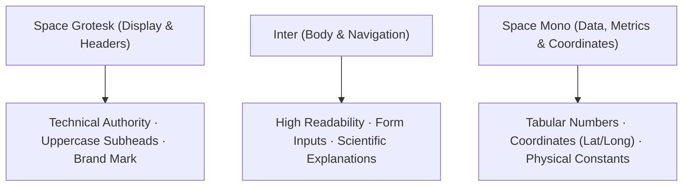

# TERRALIGN Design System — "Dark Space"

> **Version**: 1.0.0  
> **Phase**: Phase 2 — Product Design & Architecture  
> **Stitch Asset ID**: `assets/14949629949320429238`  
> **Stitch Project ID**: `projects/6700412806043990148`  
> **Governance**: Ponytail FULL (`REUSE → SIMPLIFY → IMPLEMENT`)  
> **Target Standard**: WCAG 2.2 Level AA

---

## 1. Visual Foundation & Philosophy

TERRALIGN is built on the **"Dark Space"** aesthetic — a high-contrast, cinematic, aerospace flight-operations interface designed for planetary scientists, mission planners, and exploration engineers. 

### Core Design Tenets
1. **Scientific Authority over Decoration**: Every visual element serves data analysis, mission planning, or decision support. Zero decorative fluff, zero purple gradients, zero generic SaaS card grids.
2. **Provenance Visibility**: Every metric, surface property, and terrain dataset explicitly reveals its source (NASA PDS, USGS 3DEP, Copernicus, or peer-reviewed DOI).
3. **Transparent Uncertainty**: Incomplete data and heuristic assumptions are visually distinct (dashed borders, amber warnings, explicit "Uncharacterized" badges). Missing data is never hidden.
4. **Physical Demarcation**: Earth analog properties, lunar reference conditions, and Martian reference conditions use distinct semantic colors to prevent cognitive confusion.

---

## 2. Color Palette & Semantic Tokens

### 2.1 Base Canvas & Surface Tones
| Token | Hex Value | Purpose / Usage | WCAG Contrast on Deep Space |
|:---|:---|:---|:---:|
| `color-bg-space` | `#050811` | Deep-space root canvas background | Canvas base |
| `color-bg-surface` | `#0A192F` | Primary panel / card surface | 1.3:1 (Subtle elevation) |
| `color-bg-elevated` | `#112240` | Raised modals, popovers, active selection states | 1.8:1 |
| `color-border-subtle` | `rgba(139, 156, 181, 0.15)` | Container dividers and panel borders | UI boundary |
| `color-border-focus` | `#00D4AA` | Keyboard focus ring & active outline | 8.9:1 |

### 2.2 Semantic Domain Accents
| Token | Hex Value | Meaning / Application | Contrast vs `#050811` |
|:---|:---|:---|:---:|
| `color-accent-terrestrial` | `#00D4AA` | **Earth Analog Marker**: Primary CTA, selected sites, terrestrial telemetry | 11.2:1 (AAA) |
| `color-accent-lunar` | `#1E90FF` | **Lunar Surface Marker**: Moon targets, LOLA DEM layers, cold vacuum data | 6.8:1 (AA) |
| `color-accent-martian` | `#FF6B35` | **Martian Surface Marker**: Mars targets, HiRISE data, oxidized basalt | 6.5:1 (AA) |
| `color-status-success` | `#00D4AA` | High Confidence ($C \ge 0.85$), requirement satisfied | 11.2:1 (AAA) |
| `color-status-warning` | `#FFB800` | Moderate Confidence ($0.60 \le C < 0.85$), unvalidated heuristic | 9.4:1 (AAA) |
| `color-status-danger` | `#FF4757` | Low Confidence ($C < 0.60$), inescapable reality gap | 5.2:1 (AA) |
| `color-status-exact` | `#38BDF8` | Invariant physical constant ($g$, $c$, $k_B$) | 9.8:1 (AAA) |

### 2.3 Typography & Text Levels
| Token | Hex Value | Purpose | Contrast vs `#0A192F` |
|:---|:---|:---|:---:|
| `color-text-primary` | `#F8FAFC` | Primary headlines, key metrics, active tab labels | 14.8:1 (AAA) |
| `color-text-secondary` | `#CBD5E1` | Body prose, table values, component labels | 10.5:1 (AAA) |
| `color-text-muted` | `#8B9CB5` | Metadata citations, inactive tabs, scale units | 5.4:1 (AA) |
| `color-text-disabled` | `#475569` | Unavailable operations, uncharacterized attributes | 3.1:1 |

---

## 3. Typography System

TERRALIGN uses a strictly functional three-tier typography hierarchy:

### 3.1 Type Scale & Application
| Level | Font Family | Size / Line Height | Weight | Tracking | Usage |
|:---|:---|:---|:---:|:---:|:---|
| **Display-1** | Space Grotesk | `32px / 40px` | Bold (700) | `-0.02em` | Main Screen Titles, ARG Composite Value |
| **Headline-2** | Space Grotesk | `24px / 32px` | SemiBold (600) | `-0.01em` | Section Headers, Panel Titles |
| **Headline-3** | Space Grotesk | `18px / 26px` | Medium (500) | `0em` | Card Titles, Modal Headers |
| **Body-Large** | Inter | `16px / 24px` | Regular (400) | `0em` | Primary Narrative, Lead Descriptions |
| **Body-Medium** | Inter | `14px / 20px` | Regular (400) | `0em` | Table Content, Filter Labels |
| **Body-Small** | Inter | `12px / 16px` | Medium (500) | `+0.01em` | Badges, Tooltips, Subtext |
| **Data-Large** | Space Mono | `20px / 28px` | Bold (700) | `0em` | Primary Numeric Readouts ($S$, $\text{ARG}$, $C$) |
| **Data-Medium** | Space Mono | `14px / 20px` | Regular (400) | `0em` | Coordinates, Elevation, Slope, Wavelength |
| **Data-Small** | Space Mono | `11px / 16px` | Regular (400) | `+0.02em` | DOIs, Timestamp, Dataset IDs, Telemetry |

---

## 4. Component Primitives & Styling Guidelines

### 4.1 Card & Panel Containers
- **Border Radius**: Consistent `8px` (`ROUND_EIGHT`). Never pill-shaped cards or sharp 90-degree industrial boxes.
- **Background**: Solid `#0A192F` or translucent `rgba(10, 25, 47, 0.85)` with `backdrop-filter: blur(12px)`.
- **Border**: `1px solid rgba(139, 156, 181, 0.15)`. Active/selected state upgrades to `1px solid #00D4AA` with subtle `0 0 16px rgba(0, 212, 170, 0.2)` elevation glow.
- **Padding**: Uniform `16px` (compact) or `24px` (generous).

### 4.2 Buttons & Interactive Controls
- **Primary CTA**: `#00D4AA` fill with `#050811` bold text. Hover shifts to `#00F0C0`. Focus ring: `2px solid #00D4AA`, offset `2px`.
- **Secondary Outlined**: Transparent background, `1px solid rgba(139, 156, 181, 0.4)`, `#F8FAFC` text. Hover shifts to `rgba(0, 212, 170, 0.15)` with `#00D4AA` border.
- **Toggle Cards**: Equal-height clickable cards (e.g., Moon vs Mars). Active state features a persistent `2px solid #00D4AA` border and localized accent glow.
- **Range Sliders**: Track height `4px` in `#112240`, active fill in `#00D4AA`, thumb `16px` circle in `#00D4AA` with focus outline.

### 4.3 Scientific Telemetry & Provenance Badges
- **DOI Badge**: Outline pill with book/archive icon, monospace DOI text, clickable to official resolver (`https://doi.org/...`).
- **Confidence Badge**:
  - `HIGH CONFIDENCE ($C \ge 0.85$)`: Emerald background `rgba(0, 212, 170, 0.15)`, text `#00D4AA`.
  - `MODERATE CONFIDENCE ($0.60 \le C < 0.85$)`: Amber background `rgba(255, 184, 0, 0.15)`, text `#FFB800`.
  - `LOW CONFIDENCE ($C < 0.60$)`: Red background `rgba(255, 71, 87, 0.15)`, text `#FF4757`.
- **Missing Data Flag**: Dashed border `1px dashed #FFB800`, italicized label *"Uncharacterized Parameter"*.

---

## 5. Responsive Breakpoints & Layout Grid

| Breakpoint Name | Min Width | Target Devices | Layout Behavior |
|:---|:---:|:---|:---|
| `sm` | `640px` | Large phones (landscape) | Single-column stacked cards, full-width drawers |
| `md` | `768px` | Standard tablets (portrait) | 2-column grid, collapsible sidebars |
| `lg` | `1024px` | Tablets (landscape) / Laptops | 2-column split (35% command, 65% map/studio) |
| `xl` | `1280px` | Standard Desktop Workstations | 3-column / synchronized dual viewports |
| `2xl` | `1536px` | Ultrawide Mission Control Displays | Full high-density telemetry canvas (2560px optimized) |

---

## 6. Motion & Animation Standards

1. **Duration**: Fast, precise transitions (`150ms` for buttons/hover, `250ms` for drawer slide-ins, `400ms` for 3D camera transitions).
2. **Easing**: Standard cubic-bezier `cubic-bezier(0.16, 1, 0.3, 1)` (ease-out-expo) for natural deceleration.
3. **Motion Reduction**: Full support for `prefers-reduced-motion: reduce` — eliminates camera fly-to animations and glowing pulse cycles, substituting instant opacity fades.

