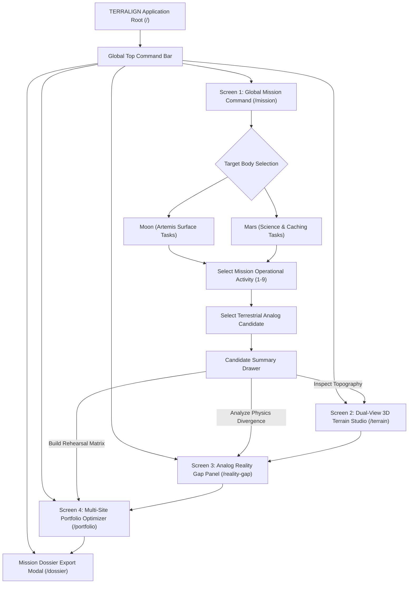
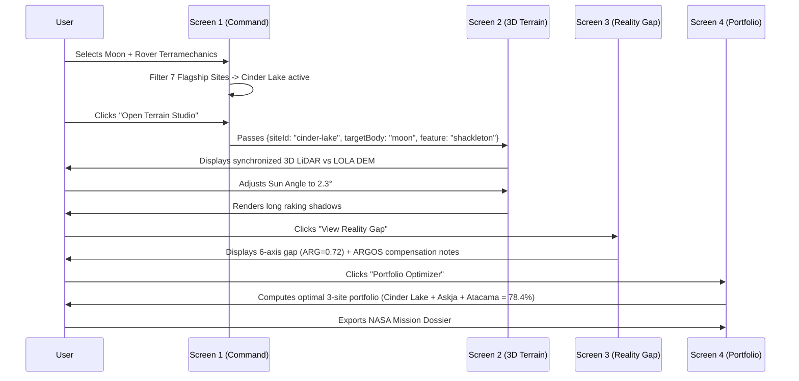

# TERRALIGN Information Architecture (IA)

> **Phase**: Phase 2 — Product Design & Architecture  
> **Status**: Approved Design Specification  
> **Standard**: Hierarchical & Task-Oriented Navigation

---

## 1. Global Sitemap & Page Topology

TERRALIGN follows a task-oriented hierarchy centered on the researcher's workflow:

---

## 2. Screen-by-Screen Information Hierarchy

### 2.1 Screen 1 — Mission Command & Activity Selector (`/mission`)
1. **Primary Navigation Bar**: Brand identity, cross-screen navigation, global dataset sync state.
2. **Mission Configuration Sidebar (35% width)**:
   - Planetary Body Toggle (Moon vs. Mars).
   - Operational Activity Selector (9 discrete surface tasks).
   - Scientific Attribute Filters (Geology, Geomorphology, Climate, Dataset availability).
   - Portfolio synthesis link (cross-cutting framework).
3. **Cartographic Discovery Map (65% width)**:
   - Global interactive MapLibre map with dark NASA bathymetry/landmass tiles.
   - 7 Flagship site markers with glowing status rings and coordinates.
   - Reticle lock and active selection tooltip.
4. **Candidate Summary Drawer (Bottom dock)**:
   - Site title, coordinates, elevation, geologic setting.
   - 5-Dimensional resemblance score bar ($S$).
   - Metric Confidence Badge ($C$).
   - Primary CTAs: *Open Terrain Studio* & *View Reality Gap*.

### 2.2 Screen 2 — Dual-View 3D Terrain Comparison Studio (`/terrain`)
1. **Dual Synchronized Viewports (80% width)**:
   - **Left Viewport**: Terrestrial Analog (USGS 3DEP LiDAR, $1\text{m}$ resolution).
   - **Right Viewport**: Planetary Target (NASA LRO LOLA DEM, $5\text{m}$ resolution).
   - Camera link reticle, scale bar ($500\text{m}$), illustrative preview watermarks.
2. **Terrain Controls & Analysis Sidebar (20% width)**:
   - View synchronization controls (camera lock, azimuth sync, 1:1 zoom).
   - Layer toggles (elevation hypsometric tint, hillshade, contours).
   - Low-Angle Solar Illumination Slider ($0.0^\circ\text{ to }5.0^\circ$) + Azimuth Dial ($135^\circ$).
   - Topographic metric cards (Slope, Roughness RMS, Elevation span, Crater density).
   - Data disparity advisory alert.

### 2.3 Screen 3 — Analog Reality Gap (ARG) Diagnostic (`/reality-gap`)
1. **Context Header**: Analog-target pair designation, target mission task, Composite ARG Index readout ($\text{ARG} = 0.72$).
2. **6-Axis Diagnostic Grid (3×2)**:
   - Gravity Disparity ($\Delta g = 8.19\text{ m/s}^2$).
   - Atmospheric Pressure Gradient ($\Delta p = 86.1\text{ kPa}$).
   - Thermal Boundary Delta ($\Delta T \approx 218^\circ\text{C}$).
   - Solar Irradiance Variance ($\Delta I = 361\text{ W/m}^2$).
   - Radiation Flux ($\Delta R \approx 377\text{ mSv/yr}$).
   - Regolith Cohesion & Morphology (mechanical & electrostatic delta).
3. **Simulator Experimental Compensation Protocols Table**:
   - Proposed engineering mitigation matrix with hardware facilities (ARGOS, TVAC, LHS-1 simulant beds).
   - Prominent unvalidated engineering proposal disclaimers.

### 2.4 Screen 4 — Multi-Site Rehearsal Portfolio Optimizer (`/portfolio`)
1. **Objective Header**: Campaign designation, portfolio size ($k \in \{2, 3\}$), greedy submodular algorithm, unvalidated hypothesis guardrail banner.
2. **Portfolio Composition Column (40% width)**:
   - Total empirical coverage metric ($78.4\%$) with hypothesis delta callout ($\Delta -11.6\%$).
   - 3 Constituent site cards with individual contribution percentages and distinct operational roles.
   - Domain orthogonality diagram.
3. **Requirements Verification Matrix (RVM) (60% width)**:
   - 30 NASA-derived testing requirements across 4 domains.
   - Site-by-site pass/fail status ($\theta \ge 0.70$).
   - Inescapable physics gaps classification (Vacuum, Gravity, Radiation, Cryo).
4. **Campaign Action Bar**: Logistics complexity metric, export dossier CTA.

---

## 3. Data Flow Between Screens

