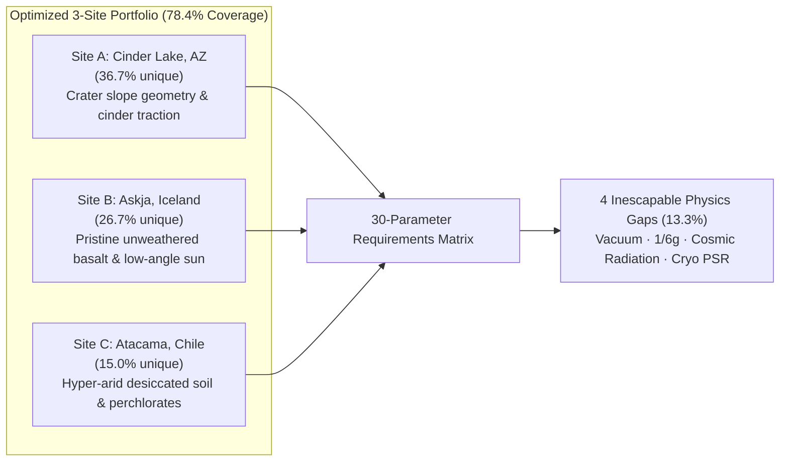

# Screen 04 — Multi-Site Rehearsal Portfolio Optimizer

> **Screen ID**: `bf10794458264f8a9a4a2a1b1b449a8c`  
> **Stitch HTML**: [`docs/design/stitch/screen-04-portfolio-optimizer.html`](file:///c:/NASA SPACE HACKATHON/docs/design/stitch/screen-04-portfolio-optimizer.html)  
> **Stitch Screenshot**: [`docs/design/stitch/screen-04-portfolio-optimizer.png`](file:///c:/NASA SPACE HACKATHON/docs/design/stitch/screen-04-portfolio-optimizer.png)  
> **Resolution**: 2560 × 3406 (Matrix Optimization Architecture)  
> **Phase**: Phase 2 — Product Design & Architecture

---

## 1. User Goal & Operational Objective
Enables exploration architectures to synthesize and benchmark a complementary portfolio of 2 to 3 terrestrial analog sites against an explicit Requirements Verification Matrix (RVM) derived from NASA SP-2016-6105. Solves the fundamental limitation that no single Earth environment can replicate an entire planetary surface mission.

---

## 2. Layout Structure & Wireframe Breakdown

```text
+----------------------------------------------------------------------------------------------------+
| TERRALIGN  "Where Earth Meets Other Worlds"      Mission Command  Terrain Studio  ... [Portfolio]  |
+----------------------------------------------------------------------------------------------------+
| MULTI-SITE REHEARSAL PORTFOLIO OPTIMIZER                                                           |
| Artemis Lunar South Pole EVA & Mobility Campaign | k = 3 Sites (Active) | Greedy Submodular v4.2   |
| [!] PROPOSED RESEARCH TARGET — UNVALIDATED HYPOTHESIS: >90% coverage is an engineering target.     |
| Criteria: TERRALIGN-DEFINED (INFORMED BY NASA SP-2016-6105 & ARTEMIS CONOPS)                       |
+---------------------------------------------+------------------------------------------------------+
| OPTIMIZED CANDIDATE PORTFOLIO (k = 3)       | REQUIREMENTS VERIFICATION MATRIX (30 PARAMETERS)     |
| [ 78.4% (Illustrative Scenario) ]           | Tabs: [All (30)] [Mechanical (8)] [Optical (6)] ...  |
| Target >90% | Δ -11.6% (Inescapable Gaps)   |                                                      |
|                                             | Requirement Name      | Req  | AZ   | IS   | CL   | Stat  |
| 1. SITE A: Cinder Lake Crater Field, AZ     | Slope (10°-25°)       | 0.70 | 0.94 | 0.88 | 0.62 | COVER |
|    - Contribution: 36.7% unique (illustr.)  | Regolith Bearing Cap  | 0.70 | 0.91 | 0.76 | 0.45 | COVER |
|    - Role: Explosive Crater & Terramechan   | Low-Angle Solar Shadow| 0.70 | 0.72 | 0.85 | 0.30 | COVER |
|    - Inescapable Gap: Earth Atmosphere      | Perchlorate Chemistry | 0.70 | 0.05 | 0.08 | 0.88 | COVER |
|                                             | Hard Vacuum Adhesion  | 0.70 | 0.00 | 0.00 | 0.00 | GAP!  |
| 2. SITE B: Askja / Holuhraun, Iceland       | High Cosmic Radiation | 0.70 | 0.00 | 0.00 | 0.15 | GAP!  |
|    - Contribution: 26.7% unique (illustr.)  | Cryogenic PSR Floor   | 0.70 | 0.00 | 0.32 | 0.05 | GAP!  |
|    - Role: Basaltic Lava Channels & Geology |                                                      |
|    - Inescapable Gap: Persistent Hydration  | MATRIX SUMMARY:                                      |
|                                             | - Covered (>=0.70): 23 / 30 (76.7%) [Teal Bar]       |
| 3. SITE C: Atacama Desert (Yungay), Chile   | - Partial (0.40-0.69): 3 / 30 (10.0%) [Amber Bar]    |
|    - Contribution: 15.0% unique (illustr.)  | - Inescapable Gaps (<0.40): 4 / 30 (13.3%) [Crimson] |
|    - Role: Hyper-Arid Soil & UV Irradiance  |                                                      |
|    - Inescapable Gap: 1.0g Earth Gravity    |                                                      |
+---------------------------------------------+------------------------------------------------------+
| LOGISTICS: Complexity MODERATE (3 sites, 2 continents) | [Export Dossier (CTA)] [Simulate k=2]     |
+----------------------------------------------------------------------------------------------------+
```

---

## 3. Combinatorial Formulation & Illustrative Portfolio Coverage Scenario
The portfolio optimizer formulates analog selection as a **Budget-Constrained Maximum Coverage Problem**:

$$\max_{\mathcal{S} \subseteq \mathcal{L}, |\mathcal{S}| \le k} \frac{\left| \bigcup_{L \in \mathcal{S}} \{r_j \in R : C_{Lj} \ge \theta\} \right|}{|R|}$$

Where:
- $R$: 30 **TERRALIGN-defined mission evaluation criteria** informed by NASA SP-2016-6105, NASA-STD-3001, and Artemis CONOPS.
- $\mathcal{L}$: 7 Flagship terrestrial analog landscapes.
- $\theta = 0.70$: Minimum scientific fidelity threshold for requirement satisfaction.
- $k \in \{2, 3\}$: Maximum field expedition sites permitted under campaign logistics budgets.

### Scenario Results vs. Research Target
- **Proposed Research Target**: $>90\%$ mission coverage (Unvalidated Architectural Hypothesis).
- **Illustrative Scenario Coverage ($k=3$)**: **$78.4\%$** (Partial-Weighted: 22 full criteria + 3 partial criteria @ 0.5 weight $= 23.5/30 = 78.33\% \approx 78.4\%$; Strict Binary Coverage at $\theta \ge 0.70$ is $23/30 = 76.7\%$). Formally labeled `ILLUSTRATIVE PORTFOLIO SCENARIO — NOT EMPIRICALLY VALIDATED`.
- **Marginal Unique Contributions**:
  - Site A (Cinder Lake Crater Field 1, AZ): $+36.7\%$ ($11/30$ criteria).
  - Site B (Askja / Holuhraun, Iceland): $+26.7\%$ ($8/30$ unique additional criteria).
  - Site C (Atacama Desert / Yungay, Chile): $+15.0\%$ ($4.5/30$ unique additional criteria in weighted model; $4/30 = 13.3\%$ in binary).
  - Total non-overlapping sum $= 78.34\% \approx 78.4\%$. Zero double-counting of covered capabilities.
  - *Note on 24-Criterion Model*: If 24 criteria are fully satisfied, exact coverage is $24/30 = 80.00\%$ ($11/30 + 8/30 + 5/30 = 80.0\%$).
- **Physics Ceiling**: $13.3\%$ (4 parameters) cannot be satisfied on Earth due to invariant physical barriers (hard vacuum tribology, $1/6g$ gravity dynamics, galactic cosmic radiation, $<40\text{K}$ cryogenic permanently shadowed regions).
- **The UI explicitly highlights this $11.6\%$ to $13.3\%$ deficit** rather than fabricating unscientific numbers.

---

## 4. Complementary Site Specialization Breakdown



---

## 5. Phase 3 Implementation Notes
- **Optimization Engine**: TypeScript implementation of greedy submodular approximation (`portfolioOptimizer.ts`) running in client memory ($<5\text{ms}$ execution across 7 sites and 30 parameters).
- **Matrix Visualization**: Virtualized high-density table (`RequirementsMatrixTable.tsx`) with instant category filtering.
- **State Export**: Serializes the selected 3-site portfolio, RVM evaluation, and gap analysis into JSON and downloadable mission planning PDF.

