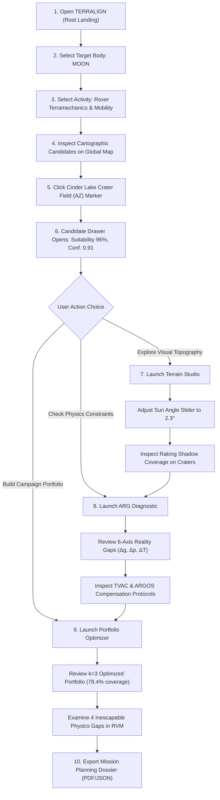

# TERRALIGN User Flows & Interaction State Models

> **Phase**: Phase 2 — Product Design & Architecture  
> **Status**: Approved UX Specification  
> **Governance**: Ponytail FULL

---

## 1. End-to-End User Journey: The Artemis Mission Planner

### Persona Context
- **User**: Dr. Elena Vance, Senior Surface Operations Lead, Artemis Lunar Surface Mobility Program.
- **Goal**: Evaluate candidate terrestrial analogs for Artemis LTV (Lunar Terrain Vehicle) low-angle lighting and slope obstacle traverse testing.

---

## 2. Interaction State Specifications

A robust research platform must handle all scientific states, not just the happy path.

### 2.1 State Matrix Across Primary Views

| State Name | Visual Indicator | Trigger / Condition | Available Actions |
|:---|:---|:---|:---|
| **Optimal Data (Happy Path)** | Solid teal border, green `HIGH CONFIDENCE` badge ($C \ge 0.85$) | High-resolution LiDAR or ground survey data present | Full 3D rendering, export, detailed metric drill-down |
| **Low Confidence / Partial Data** | Amber warning border, `MODERATE CONFIDENCE` badge ($0.60 \le C < 0.85$) | Regional climate model or uncalibrated satellite reanalysis used | View heuristic bounds $[S_{\min}, S_{\max}]$, show source caveats |
| **Uncharacterized / Missing** | Dashed yellow/red border, `UNCHARACTERIZED` badge ($C < 0.60$) | Critical parameter unmeasured at field site | Gated from mission operational sign-off; suggest field survey protocol |
| **Physical Reality Barrier** | Crimson alert badge, `INESCAPABLE REALITY GAP` | Fundamental planetary physics divergence (Earth atmosphere vs. vacuum) | Directs user to laboratory simulation facility (TVAC, ARGOS) |
| **Data Loading** | Monospace telemetry ticker, skeleton pulse `#112240` | Fetching quantized heightmap tile or LOLA orbital raster | Cancel query, retain prior cached viewport |
| **Network / Sync Error** | Red telemetry dot, `OFFLINE — LOCAL CACHE ACTIVE` | USGS or PDS node connection timeout | Switch to bundled offline flagship site profiles |

---

## 3. Detailed Component Interaction Flows

### 3.1 Dual-View Terrain Synchronization
1. **Camera Orbit**: Dragging in Left Viewport (Terrestrial) rotates the Three.js camera around target coordinate. When `Sync Camera` is ON, the Right Viewport (Lunar) updates azimuth and elevation angles simultaneously via shared orbit controller state.
2. **Sun Angle Adjustment**: Moving the `Sun Elevation Slider` from $5.0^\circ$ down to $0.5^\circ$:
   - Directs the Three.js directional light vector to $\vec{L} = (\cos\theta\cos\phi, \sin\theta, \cos\theta\sin\phi)$.
   - Shader real-time shadow map projects pitch-black cast shadows across crater rims.
   - Telemetry readout updates in real-time ($2.3^\circ$).

### 3.2 Portfolio Combinatorial Exploration
1. **Toggle $k = 2$ vs. $k = 3$**:
   - Re-evaluates greedy submodular coverage algorithm across the 30-parameter RVM.
   - Shows coverage drop from $78.4\%$ ($k=3$: Cinder Lake + Askja + Atacama) to $63.4\%$ ($k=2$: Cinder Lake + Askja).
   - Highlights Atacama's removed contribution ($15.0\%$ chemical/aridity coverage lost).

