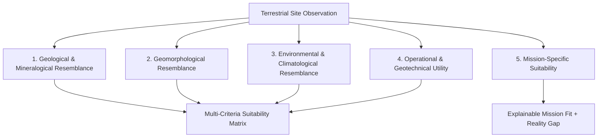

# 01 — Scientific Foundation & Analog Reality Gap

> **Module**: TERRALIGN Research Series · Document 01  
> **Challenge**: Discovery and Characterization of New Terrestrial Analogs for Lunar and Martian Exploration  
> **Status**: Verified Scientific Foundation  
> **Primary References**: NASA PDS, USGS Astrogeology Science Center, Europlanet 2024 RI, ESA PSA

---

## 1. The Core Scientific Premise

Planetary exploration is fundamentally constrained by physical access. Robotic missions to Mars and lunar Artemis missions carry immense fiscal, operational, and physical risks. To de-risk hardware, mission protocols, navigation algorithms, autonomous instruments, and crew survival systems, space agencies have historically relied on **terrestrial analogs**—Earth environments that exhibit physical, chemical, geomorphological, or operational parallels to extraterrestrial destinations.

However, historical analog research has frequently suffered from **one-dimensional characterization**: a site is declared a "Mars analog" or "Moon analog" in an unqualified manner, leading to misaligned test parameters, failed rover mechanics, or invalid astrobiological extrapolations.

TERRALIGN is built on a foundational scientific axiom:

$$\text{Analog Resemblance} \neq \text{Mission Suitability}$$

A terrestrial site may possess near-perfect mineralogical fidelity to Martian basalt while possessing completely dissimilar regolith cohesion, atmospheric boundary layers, or geotechnical trafficability.

---

## 2. The Non-Replica Law

> **The Non-Replica Law**: No environment on Earth is an exact replica of the Moon or Mars. Every terrestrial analog is domain-specific, partial, and physically bounded by Earth's unique planetary evolution.

To maintain scientific credibility, TERRALIGN formalizes the **5 Dimensions of Planetary Resemblance**:

### The 5 Dimensions Defined:

1. **Geological & Mineralogical Resemblance**:
   - Primary mineralogy (olivine, pyroxene, plagioclase feldspar, anorthosite).
   - Secondary alteration products (phyllosilicates/clays, sulfates, carbonates, iron oxides, perchlorates).
   - Provenance: Basaltic volcanism, hydrothermal alteration, impact shock metamorphism.
2. **Geomorphological Resemblance**:
   - Landform structures (impact craters, lava tubes, sinuous rilles, barchan dunes, yardangs, inverted fluvial channels, gullies).
   - Scale, slope distribution, surface roughness ($z_0$), and digital elevation profile.
3. **Environmental & Climatological Resemblance**:
   - Temperature extremes, diurnal cycles ($\Delta T$), hyper-aridity (low precipitation, low relative humidity).
   - Solar irradiance, solar UV flux ($200\text{--}400\text{ nm}$), desiccating winds.
4. **Operational & Geotechnical Utility**:
   - Substrate trafficability, soil shear strength, bearing capacity ($\text{kPa}$), wheel sinkage, boulder distribution frequency ($C_f$).
   - Logistics, line-of-sight communications, remote field operations, spacesuit mobility constraints.
5. **Mission-Specific Suitability**:
   - Fitness evaluated strictly against the target mission activity (e.g., Artemis III South Pole lighting rehearsal vs. Mars Sample Return drill caching).

---

## 3. The Analog Reality Gap (ARG)

Every analog evaluation must explicitly state and quantify the **Analog Reality Gap**.

| Environmental Factor | Earth Baseline | Lunar South Pole | Mars (Equatorial / Mid-Lat) | Scientific Impact on Analog Fidelity |
|:---|:---:|:---:|:---:|:---|
| **Surface Gravity ($g$)** | $9.81\text{ m/s}^2$ ($1.0g$) | $1.62\text{ m/s}^2$ ($0.166g$) | $3.71\text{ m/s}^2$ ($0.38g$) | Wheel tractive effort, dust ballistic trajectories, slip ratios, rover tip-over angles. |
| **Atmospheric Pressure** | $101.3\text{ kPa}$ ($1\text{ atm}$) | Hard Vacuum ($<10^{-10}\text{ Pa}$) | $0.61\text{--}1.0\text{ kPa}$ ($0.006\text{ atm}$, $\text{CO}_2$) | Aerodynamic drag, convective cooling, parachute dynamics, rotorcraft lift (Ingenuity). |
| **Solar Irradiance** | $\sim 1000\text{ W/m}^2$ (sea level) | $\sim 1361\text{ W/m}^2$ (TOA) | $\sim 590\text{ W/m}^2$ (TOA) | Solar panel power output, thermal equilibrium, thermal infrared signatures. |
| **Radiation Flux** | Magnetosphere protected ($<1\text{ mSv/yr}$) | $60\text{--}100\text{ mSv/yr}$ (GCR + SPE) | $200\text{--}300\text{ mSv/yr}$ (thin atmosphere) | Radiation-induced instrument noise, electronics Single Event Upsets (SEU), biological survival. |
| **Regolith Particle Physics** | Rounded by water/wind erosion | Jagged, razor-sharp, electrostatically charged | Sub-micron sharp dust, oxidized ($\text{Fe}_2\text{O}_3$), perchlorate-laced | Seal abrasion, spacesuit fabric wear, solar panel obscuration, respiratory toxicity. |
| **Hydrological Cycle** | Active liquid water cycle | No liquid water; permanent shadow ice ($<100\text{ K}$) | Ephemeral brines only; subsurface permafrost / polar caps | Earth weathering rapidly destroys primary minerals (e.g., olivine alters to serpentine). |

---

## 4. Methodological Verification Principles

To uphold NASA-grade scientific rigor:
1. **Provenance Mandate**: Every analog profile in TERRALIGN must trace its primary coordinates, spectral bands, and geotechnical values to published USGS Open-File Reports, NASA Technical Reports Server (NTRS), or peer-reviewed literature (e.g., *Icarus*, *Journal of Geophysical Research: Planets*, *Astrobiology*).
2. **Uncertainty Quantification**: Environmental variables with seasonal flux or uncalibrated measurement must carry formal confidence bounds ($\pm \sigma$ or qualitative rating: *High*, *Medium*, *Inferred*).
3. **Explicit Exclusion Criteria**: Any analog site lacking measured ground-truth data must be classified as *Candidate / Uncharacterized*, never given an unvalidated synthetic suitability score.

