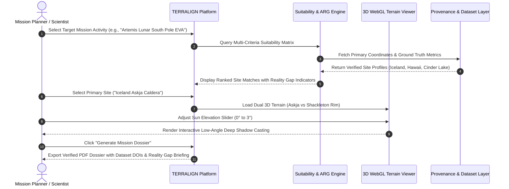

# 07 — User Personas & Operational Exploration Workflows

> **Module**: TERRALIGN Research Series · Document 07  
> **Challenge**: Discovery and Characterization of New Terrestrial Analogs for Lunar and Martian Exploration  
> **Status**: Verified User-Centered Architecture  
> **Stakeholders**: NASA Artemis Planning, ESA Pangaea, University Planetary Groups

---

## 1. Targeted User Personas

### Persona 1: Dr. Elena Vance — Artemis Surface Mission Planner
- **Role**: Lead Mission Trajectory & Surface Operations Architect (NASA / Contractor).
- **Core Problem**: Selecting terrestrial training grounds for Artemis III/IV astronauts to practice lunar South Pole sampling while navigating low-elevation sun angles ($1^\circ\text{--}3^\circ$).
- **Current Pain Points**: Existing databases are static PDFs; cannot interactively simulate micro-shadows on complex terrain; lacks clear metrics on how Earth atmospheric scattering distorts shadow contrast.
- **Expected Output**: A defensible site recommendation (e.g., Askja rim, Iceland) with quantitative lighting comparison to Shackleton crater rim, complete with a reality gap briefing for astronaut trainers.
- **TERRALIGN Value**: Interactive 3D low-angle sun position simulator + lunar-to-analog shadow contrast profile + exportable field rehearsal dossier.

### Persona 2: Marcus Thorne — Autonomous Planetary Rover Systems Engineer
- **Role**: Mobility & Terramechanics Lead for Commercial Lunar Payload Services (CLPS) Rover.
- **Core Problem**: Finding a terrestrial proving ground that accurately simulates loose, angular basaltic cinder with high slip potential without spending millions traveling to Antarctica.
- **Current Pain Points**: Soil database values (Bekker parameters) are scattered across 40 years of Apollo literature; cannot easily compare Cinder Lake vs. Pisgah Crater slope instability against lunar mare data.
- **Expected Output**: Side-by-side geotechnical comparison showing wheel sinkage, internal friction angle, slope distribution, and logistical accessibility ratings.
- **TERRALIGN Value**: Quantitative terramechanical matching table + USGS 3DEP micro-slope heatmaps + logistical distance and permit requirements.

### Persona 3: Prof. Aisha Al-Mansoor — Astrobiologist & Instrument PI
- **Role**: Principal Investigator for Life-Detection Spectrometer (ExoMars / Mars Sample Return).
- **Core Problem**: Discovering candidate analog sites with high perchlorate salts and trace organics ($<5\text{ ppm}$) to stress-test laser desorption mass spectrometers.
- **Current Pain Points**: Atacama is well-known but expensive and over-sampled; needs to discover newly characterized candidate hypersaline or hyper-arid desert basins with similar geochemical signatures.
- **Expected Output**: Discovery query ranking global arid basins by perchlorate/sulfate concentration, water activity ($a_w$), and organic cleanliness.
- **TERRALIGN Value**: Candidate Discovery Engine + spectral signature matching to Mars MRO CRISM data.

---

## 2. End-to-End User Workflows

