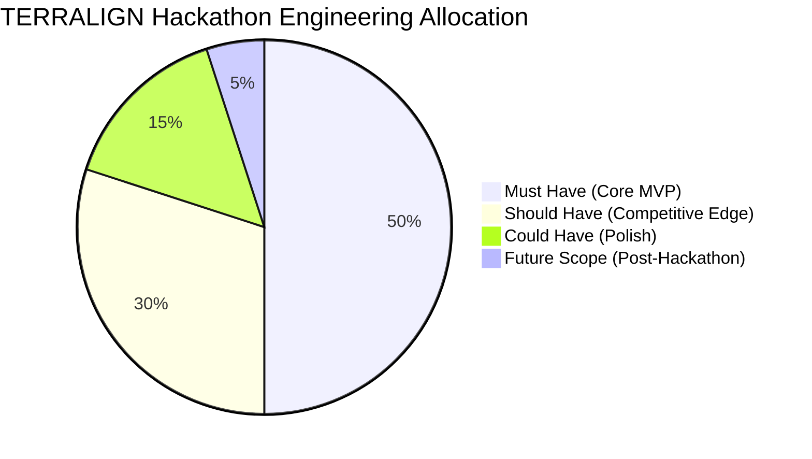

# 08 — Feature Prioritization & MVP Scope (MoSCoW Matrix)

> **Module**: TERRALIGN Research Series · Document 08  
> **Challenge**: Discovery and Characterization of New Terrestrial Analogs for Lunar and Martian Exploration  
> **Status**: Verified Product Roadmap  
> **Governance**: Ponytail FULL Mode (Strict Minimal Implementation)

---

## 1. Feature Prioritization Matrix (MoSCoW)

### 1. Must Have (P0 — Core MVP Foundation)
- [x] **Activity-Specific Suitability Search**: Filter analogs by target planetary body (Moon vs. Mars) and mission activity (Rover Mobility, EVA Training, Drill Caching, Lava Tube Exploration, Lighting Rehearsal).
- [x] **Verified Analog Landscape Profiles (7 Flagship Sites)**: Detailed ground-truth profiles for Atacama, McMurdo Dry Valleys, Iceland Askja/Holuhraun, Hawaii Mauna Kea/Loa, Cinder Lake/Mojave, Utah San Rafael Swell, Devon Island HMP.
- [x] **Interactive 3D Terrain Comparison Viewer**: WebGL/Three.js view rendering high-resolution elevation meshes for Earth analog sites alongside corresponding Lunar/Martian surface profiles.
- [x] **The Analog Reality Gap (ARG) Panel**: Quantified 6-axis gap breakdown (Gravity, Atmosphere, Temperature Delta, Solar Irradiance, Radiation, Regolith Abrasiveness) with explicit simulator compensation advice.
- [x] **Scientific Provenance Badges**: Every site property and metric links directly to authoritative sources (NASA PDS, USGS, ESA, peer-reviewed literature DOIs).

### 2. Should Have (P1 — Competitive Differentiators)
- [x] **Lunar South Pole Sun Angle & Shadow Traversal Simulator**: Dynamic sun elevation slider ($0^\circ\text{--}5^\circ$) casting real-time raytraced shadows across high-relief terrain models.
- [x] **Multi-Site Rehearsal Portfolio Generator (Proposed Research Target)**: Algorithm suggesting complementary 2-to-3 site combinations targeting $>90\%$ of mission validation requirements (formulated as a combinatorial set-cover optimization hypothesis to be validated against formal mission requirements matrices).
- [x] **Candidate Discovery & Novelty Classifier**: Explorer tool filtering global terrestrial coordinates by user-defined slope, aridity, and mineralogical criteria.
- [x] **Mission Dossier Export**: Generate a printable, presentation-ready mission planning summary with provenance citations.

### 3. Could Have (P2 — Delight & Polish)
- [ ] Atmospheric Filter Toggle (Visualize Mars forward Mie dust scatter vs. Earth Rayleigh blue sky).
- [ ] Soundscape synthesis (wind speed modeling based on Martian atmospheric density).
- [ ] Rover model scale reference overlay (Artemis LTV or Perseverance CAD model placed in 3D terrain).

### 4. Future Scope (P3 — Post-Hackathon / Production Enterprise)
- [ ] Direct live integration with NASA PDS Orbital Data Explorer API for automated raster downloading.
- [ ] On-demand satellite tasking for high-resolution PlanetScope imagery of newly discovered analog candidates.
- [ ] Collaborative multiplayer multi-user astronaut traverse planning in virtual reality (WebXR).

---

## 2. Why This MVP Wins
This MVP deliberately eliminates decorative SaaS fluff (no generic blog posts, no fake testimonials, no opaque AI chatbot windows). Every feature directly serves an operational mission planning need, provides measurable scientific value, and can be demonstrated live within the standard 3-to-5 minute hackathon judging window.

