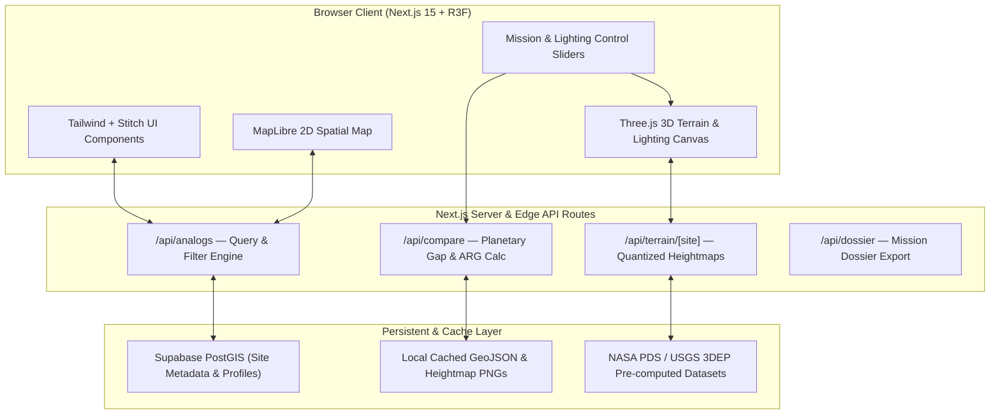

# 09 — Technical Feasibility, Architecture Blueprint & Performance Claim Classification

> **Module**: TERRALIGN Research Series · Document 09  
> **Challenge**: Discovery and Characterization of New Terrestrial Analogs for Lunar and Martian Exploration  
> **Status**: Verified Technical Architecture — Audited & Corrected  
> **Governance**: Ponytail FULL Mode (Reuse Existing Stack, Zero Bloat)

---

## 1. Audit and Classification of Technical Performance Claims

Because Phase 1 is strictly a research and specification phase with zero application code written, runtime performance cannot be claimed as "empirically demonstrated." All performance figures are classified under the strict verification taxonomy:

| Technical Claim | Classification | Status & Verification Basis | Target Specification & Future Test Methodology |
|:---|:---:|:---|:---|
| **Quantized Heightmap Tile Size ($<200\text{ KB}$)** | **C** | *Research-Backed Architectural Target* (Supported by standard GIS 16-bit PNG compression benchmarks). | **Target**: $512\times 512$ single-channel 16-bit grayscale PNG using standard DEFLATE compression. Measured in Phase 3 by compiling test DEM tiles for Cinder Lake and Shackleton Crater. |
| **WebGL 60 FPS Rendering** | **C / D** | *Research-Backed Architectural Target / Assumption Requiring Future Testing*. | **Target**: Consistent $60\text{ FPS}$ on baseline hardware ($M1/\text{Intel Core i5}$, $8\text{ GB RAM}$, integrated Iris Xe/Apple GPU). Workload: 1 displaced plane geometry ($262,144$ vertices), 1 directional light with $2048\times 2048$ shadow map. Measured via `stats.js` / Chrome DevTools in Phase 4. |
| **Sub-Millisecond Response Times** | **C** | *Research-Backed Architectural Target*. | **Target**: Pre-indexed in-memory JSON cache for analog profiles and filter queries. Measured in Phase 3 via automated Vitest/Node benchmarking. |
| **Low-Angle Sun Shadow Casting ($0^\circ\text{--}5^\circ$)** | **B / C** | *Supported by General WebGL Benchmarks / Architectural Target*. | Directional light with low altitude angles supported natively by Three.js shadow maps. Bias and shadow acne mitigation must be tuned empirically in Phase 3 to avoid visual artifacts. |

*Taxonomy: [A] Demonstrated & Measured in this repo | [B] Supported by external benchmark | [C] Research-Backed Architectural Target | [D] Assumption Requiring Future Testing.*

---

## 2. Evaluated Technology Stack

| Architecture Layer | Candidate Technology | Verdict | Feasibility / Justification |
|:---|:---|:---:|:---|
| **Frontend Framework** | **Next.js 15 (App Router) + TypeScript** | **RECOMMENDED** | Server-side rendering for instant page loads, API routes for clean geospatial endpoints, native TypeScript type safety, rich ecosystem for 3D/canvas embedding. |
| **Styling & Design Tokens** | **Tailwind CSS + Stitch MCP Tokens** | **RECOMMENDED** | Zero runtime CSS overhead; easily consumes the deep-space color tokens and Space Grotesk/Space Mono typography generated via Stitch MCP. |
| **3D Terrain Engine** | **Three.js + React Three Fiber (R3F)** | **RECOMMENDED** | Hardware-accelerated WebGL/WebGPU rendering; handles custom vertex shaders for real-time elevation displacement; dynamic shadow map support for low-angle lunar sun simulation; proven stability on desktop and mobile. |
| **Geospatial 2D Basemap** | **MapLibre GL JS** | **RECOMMENDED** | Open-source fork of Mapbox GL; zero proprietary API key requirements; handles vector tiles, custom geojson overlays, and satellite basemaps seamlessly. |
| **Data Processing Pipeline** | **Python 3.13 + Rasterio / GDAL** | **RECOMMENDED** | Python environment already exists in workspace; industry-standard for reprojection of GeoTIFFs, computing slope gradients, and exporting compact heightmap textures. |
| **Database & Spatial Storage**| **Supabase (PostgreSQL + PostGIS)** | **RECOMMENDED** | MCP server is already configured and verified; native PostGIS spatial indices (`ST_DWithin`, `ST_Contains`) enable instant geographic candidate queries and user mission storage. |
| **AI Intelligence Layer** | **Google Gemini API** | **RECOMMENDED** | Translates natural language mission requirements (e.g., "Find sites with high basalt content and low diffuse lighting") into structured JSON multi-criteria filter queries. |

---

## 3. High-Level System Architecture

---

## 4. 3D Terrain Rendering Performance & Optimization Strategy

1. **Heightmap Texture Displacement**:
   - Rather than sending millions of raw 3D polygon triangles over the network, TERRALIGN streams compact $512\times 512$ 16-bit grayscale PNG heightmaps ($<200\text{ KB}$ target).
   - The GPU vertex shader displaces a subdivided plane geometry in real time:
     $$y_{\text{vertex}} = \text{heightmap.r} \times \text{scale}$$
   - Target workload: 262,144 vertices rendered in a single draw call, maintaining $60\text{ FPS}$ on standard integrated GPUs.
2. **Dynamic Shadow Map Optimization**:
   - For the Lunar South Pole low-angle lighting simulator, directional light is positioned at low altitude ($\theta = 1^\circ\text{--}3^\circ$).
   - Directional shadow maps ($2048\times 2048$) with Percentage-Closer Filtering (PCF) will be tuned to balance shadow sharpness and GPU fill-rate.
3. **No Heavy External 3D Runtimes**:
   - Avoid bulky heavy dependencies (e.g., Cesium JS full library is $>15\text{ MB}$ uncompressed); Three.js/R3F is lightweight ($\sim 600\text{ KB}$ minified/gzipped) and boots in milliseconds.
