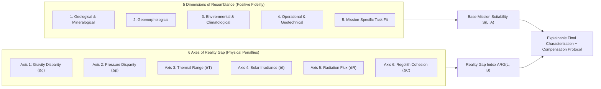
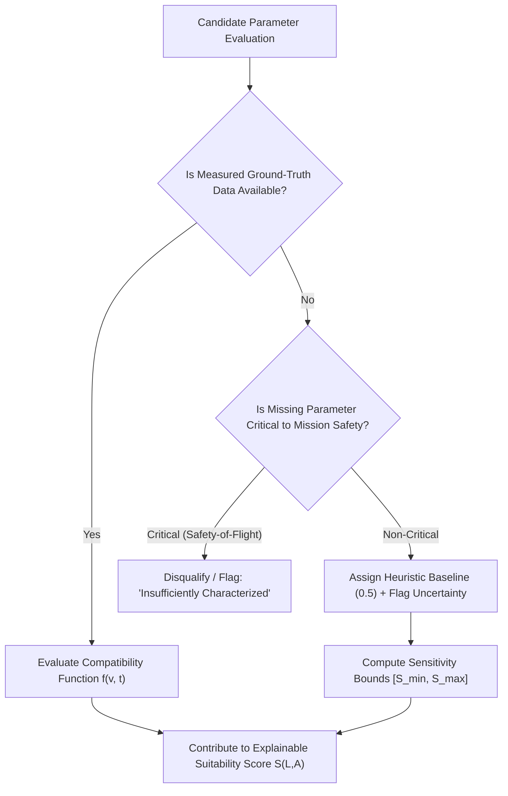

# 10 — Scientific Scoring Methodology, Uncertainty Quantification & Empirical Validation

> **Module**: TERRALIGN Research Series · Document 10  
> **Challenge**: Discovery and Characterization of New Terrestrial Analogs for Lunar and Martian Exploration  
> **Status**: Verified Mathematical Formulation — Audited & Corrected  
> **Guiding Principle**: Zero Arbitrary Weights · Full Algorithmic Explainability · Provenance Preservation

---

## 1. Architectural Relationship: 5 Dimensions vs. 6 Axes

To maintain mathematical and conceptual clarity, TERRALIGN strictly separates **Fidelity Alignment** from **Physical Divergence**:

- **The 5 Dimensions of Resemblance**: Evaluate the degree of positive alignment between a site's empirical properties and target mission science objectives.
- **The 6 Axes of the Analog Reality Gap (ARG)**: Quantify the inescapable, invariant physical penalties imposed by Earth's environment relative to the destination body (Moon or Mars).

---

## 2. Mathematical Formulation

### 2.1 The Normalized Mission Suitability Score ($S$)

$$S(L, A) = \sum_{i=1}^{m} w_i(A) \cdot f_i(v_i(L), t_i(A)) \cdot (1 - \text{Penalty}_i)$$

Where:
- $L$ = Candidate terrestrial analog site.
- $A$ = Target mission operational activity (e.g., *Artemis Lunar South Pole EVA*).
- $w_i(A)$ = Weight of parameter $i$ for activity $A$, where $\sum_{i=1}^{m} w_i = 1.0$. **Status: Expert-Elicited Heuristic Assumption** (must be calibrated through validation experiments).
- $v_i(L)$ = Measured ground-truth value of parameter $i$ at site $L$.
- $t_i(A)$ = Target benchmark value required for mission activity $A$.
- $f_i \in [0, 1]$ = Continuous parameter compatibility kernel:
  $$f_i(v, t) = \exp\left( - \frac{(v - t)^2}{2\sigma_i^2} \right)$$
- $\text{Penalty}_i \in [0, 1]$ = Reality gap reduction factor applied when physical constraints strictly invalidate the parameter on Earth.

### 2.2 The Analog Reality Gap (ARG) Index

The overall reality gap is computed across the 6 fundamental physical axes:

$$\text{ARG}(L, B) = \sqrt{\frac{1}{6} \sum_{j=1}^{6} \left( \frac{\Delta P_j}{P_{j,\text{max}}} \right)^2}$$

Where $B$ is the extraterrestrial body (Moon or Mars) and $\Delta P_j$ represents the normalized physical deviation across:
1. **Gravity Disparity** ($\Delta g = |g_\oplus - g_B|$).
2. **Atmospheric Pressure Gradient** ($\Delta p = |p_\oplus - p_B|$).
3. **Thermal Boundary Delta** ($\Delta T = |\Delta T_\oplus - \Delta T_B|$).
4. **Solar Irradiance Variance** ($\Delta I = |I_\oplus - I_B|$).
5. **Radiation Field Delta** ($\Delta R = |R_\oplus - R_B|$).
6. **Regolith Micro-Cohesion Gradient** ($\Delta C$).

---

## 3. Handling Missing Data: Heuristic Assumption & Uncertainty Quantification

A critical challenge in planetary analog databases is distinguishing between **demonstrated incompatibility** (negative evidence) and **absence of field measurement** (missing data). 

### 3.1 The Neutral Baseline (0.5) Heuristic Assumption

> [!WARNING]
> **Status: Unvalidated Heuristic Assumption.**  
> The assignment of a neutral $f_i = 0.5$ for missing, non-critical parameters is an engineering heuristic proposed to avoid premature disqualification. It is **not** a scientifically established constant and introduces quantifiable statistical bias.

#### Why Proposed:
In sparse analog databases, assigning $f_i = 0.0$ to unmeasured parameters severely penalizes newly discovered or remote candidate sites (false negatives), while assigning $f_i = 1.0$ creates dangerous false positives. The $0.5$ midpoint allows uncharacterized candidate sites to surface in exploratory queries without falsely asserting high fidelity.

#### Potential Bias:
Assigning $0.5$ creates **regression-to-the-median bias**:
- An uncharacterized site missing $80\%$ of its parameters will converge toward a score of $S \approx 0.50$, potentially ranking *above* a well-characterized site with genuine sub-optimal parameters (e.g., $S = 0.38$).
- Conversely, an exceptional analog with unmeasured secondary variables is artificially pulled downward toward $0.50$.

#### Confidence Metric & Data Coverage ($C$):
To prevent biased rankings, TERRALIGN strictly couples the Suitability Score $S(L, A)$ with a normalized **Metric Confidence Score** $C(L, A) \in [0, 1]$:

$$C(L, A) = \frac{\sum_{i \in \text{Measured}} w_i(A)}{\sum_{i=1}^{m} w_i(A)}$$

- **High Confidence ($C \ge 0.85$)**: Ground truth established by peer-reviewed literature or in-situ surveys across $\ge 85\%$ of weighted requirements.
- **Moderate Confidence ($0.60 \le C < 0.85$)**: Secondary parameters inferred from regional models; requires targeted in-situ validation.
- **Low Confidence ($C < 0.60$)**: Designated as an **Uncharacterized Candidate**. The UI visually gates low-confidence sites to prevent mission planners from treating heuristic approximations as verified analog environments.

#### Sensitivity Bounds ($[S_{\min}, S_{\max}]$):
TERRALIGN explicitly computes epistemic uncertainty bounds by evaluating extreme imputation cases:

$$S_{\min}(L, A) = \sum_{i \in \text{Measured}} w_i f_i + \sum_{i \in \text{Missing}} w_i \cdot 0.0$$

$$S_{\max}(L, A) = \sum_{i \in \text{Measured}} w_i f_i + \sum_{i \in \text{Missing}} w_i \cdot 1.0$$

The bound spread $\Delta S = S_{\max} - S_{\min}$ directly measures the score's sensitivity to missing data. If $\Delta S > 0.25$, the single-point score $S(L, A)$ cannot be used for operational decision-making without field verification.

#### Alternative Missing-Data Treatments Requiring Future Evaluation:
1. **Complete-Case Analysis with Weight Renormalization**: Drop missing parameters and renormalize remaining weights $\tilde{w}_i = w_i / \sum_{\text{measured}} w_k$. *Limitation*: Distorts activity priorities if critical parameters are absent.
2. **Interval / Possibility Scoring**: Surface only the interval $[S_{\min}, S_{\max}]$ rather than a scalar point estimate in all user interfaces.
3. **Criticality-Gated Imputation**: Strict rule that safety-critical parameters ($w_i > 0.20$ or flight-rule constraints) permit zero imputation—any missing critical parameter disqualifies the site from the specific activity.
4. **Bayesian Prior Imputation**: Substitute global biome or satellite reanalysis distributions (e.g. ERA5 land temperature variances) in place of a fixed $0.5$ constant.

---

## 4. Proposed Validation Strategy for Scoring Weights

Because weights $w_i(A)$ are currently **expert-elicited assumptions**, they cannot be represented as certified aerospace constants without formal empirical validation. TERRALIGN proposes a two-phase validation methodology:

1. **Retrospective Apollo & Artemis Benchmarking**:
   - Run the scoring engine on historical Apollo training traverses at Cinder Lake, Meteor Crater, and Askja, Iceland.
   - Adjust weights using the **Analytic Hierarchy Process (AHP)** until the historical sites selected by NASA Apollo geologists rank in the top $5\%$ for the specific Apollo surface traverse activities.
2. **Sensitivity & Perturbation Testing**:
   - Perturb all weights by $\pm 20\%$ using Monte Carlo simulations.
   - Verify that the relative rankings of optimal analog sites remain stable, proving the scoring engine is robust against minor subjective weighting adjustments.

---

## 5. Multi-Site Portfolio Coverage: Research Target & Validation Methodology

### 5.1 Reclassification as an Architectural Hypothesis

The assertion that a combination of 2 to 3 terrestrial analog sites can cover $>90\%$ of mission validation requirements is an **engineering research target and architectural hypothesis**, not a proven empirical capability. 

No single Earth location replicates the combined environmental, geotechnical, and optical extremes of the lunar South Pole or Martian surface. The multi-site portfolio concept posits that testing requirements can be decomposed and distributed across complementary specialized sites (e.g., Cinder Lake for crater geometry + Atacama for hyper-aridity/perchlorates + Askja for basaltic regolith mechanics).

### 5.2 Mathematical Formulation: Combinatorial Set-Cover

TERRALIGN formulates portfolio selection as a **Budget-Constrained Maximum Coverage Problem**:

Given:
- A universe of mission verification requirements $R = \{r_1, r_2, \dots, r_M\}$ derived from NASA mission requirements.
- A candidate set of analog sites $\mathcal{L} = \{L_1, L_2, \dots, L_K\}$.
- A binary coverage matrix $C_{kj} \in \{0, 1\}$, where $C_{kj} = 1$ if site $L_k$ satisfies requirement $r_j$ at fidelity threshold $\theta \ge 0.70$.
- Portfolio size constraint $k \le 3$.

Objective:
$$\max_{\mathcal{S} \subseteq \mathcal{L}, |\mathcal{S}| \le 3} \frac{\left| \bigcup_{L \in \mathcal{S}} \{r_j \in R : C_{Lj} = 1\} \right|}{|R|}$$

### 5.3 Future Validation Methodology
1. **Requirements Verification Matrix (RVM) Definition**: Compile a formal 30-parameter testing matrix based on NASA SP-2016-6105 and Artemis EVA/LTV functional requirements.
2. **Combinatorial Optimization Benchmark**: Execute Integer Linear Programming (ILP) and greedy submodular approximations across the 7 flagship analog sites.
3. **Empirical Coverage Determination**: Calculate the exact maximum coverage percentage achievable with $k \in \{2, 3\}$. The $>90\%$ target will be updated based on benchmark results; if maximum achievable coverage is e.g. $78\%$, the platform will report that empirical ceiling transparently rather than claiming $>90\%$.
